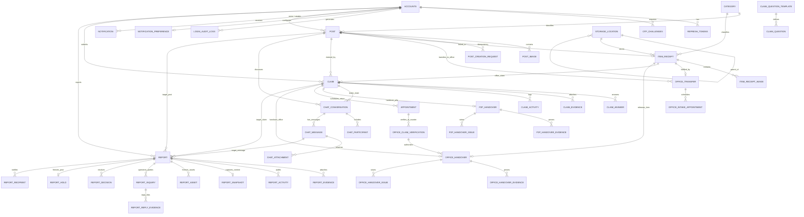
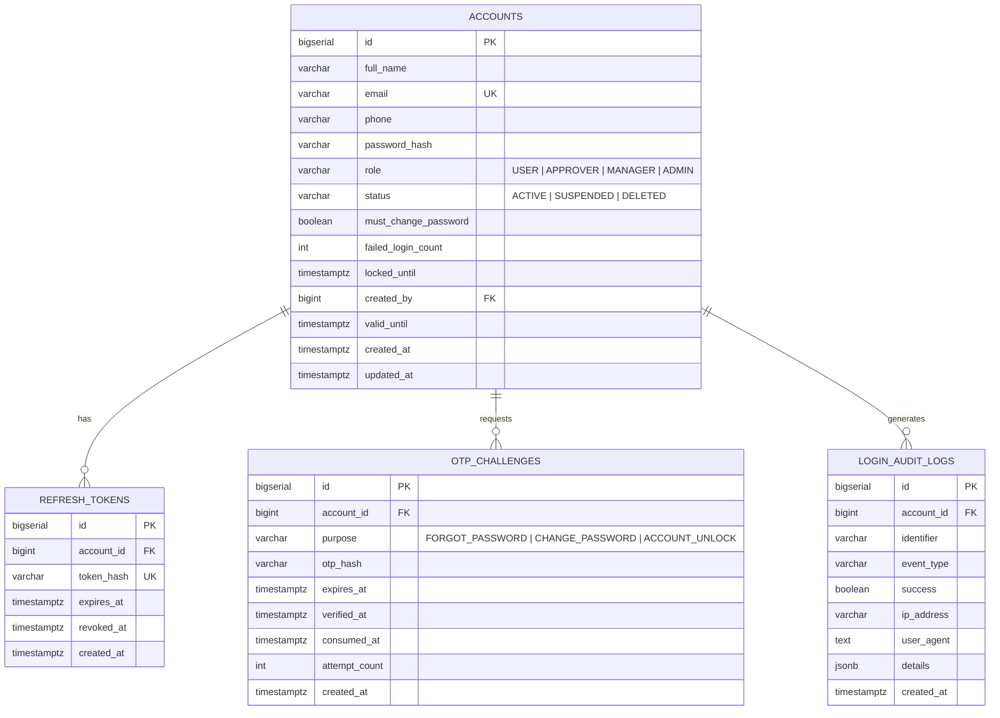
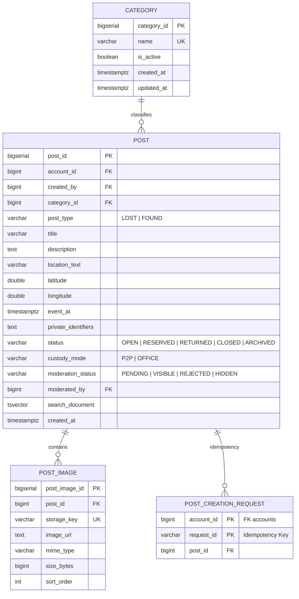
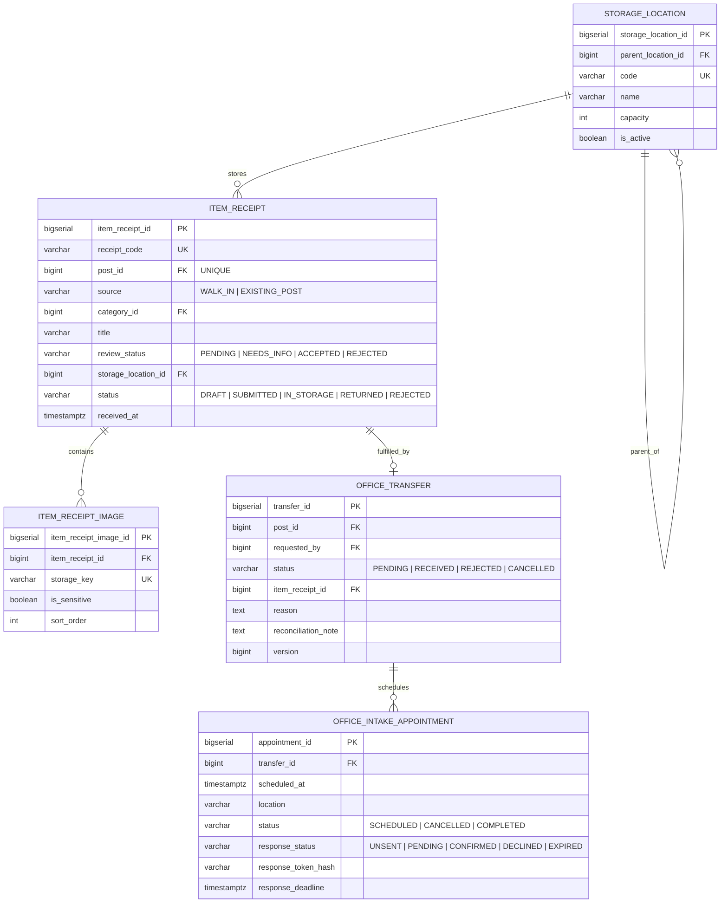
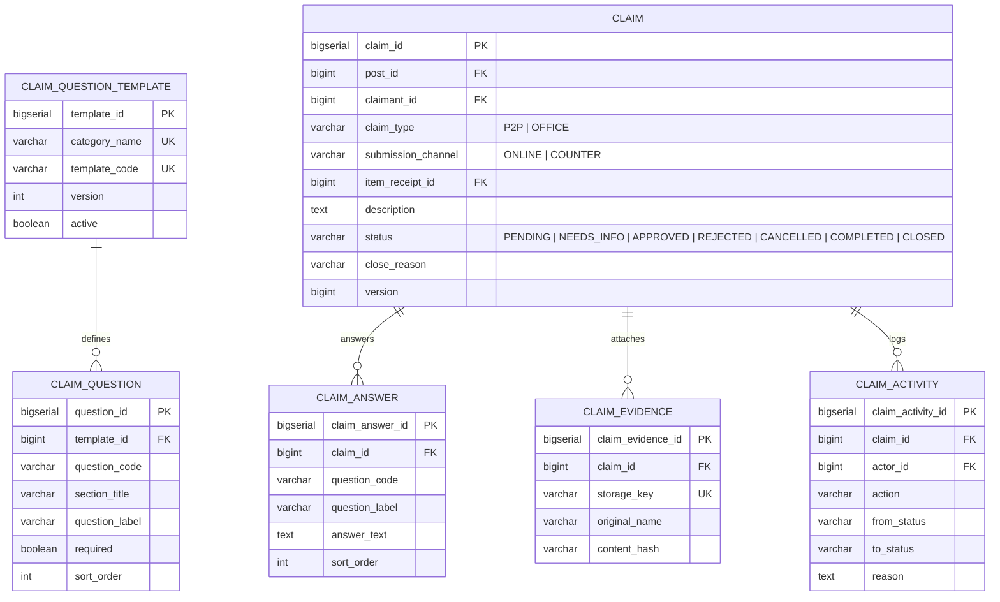
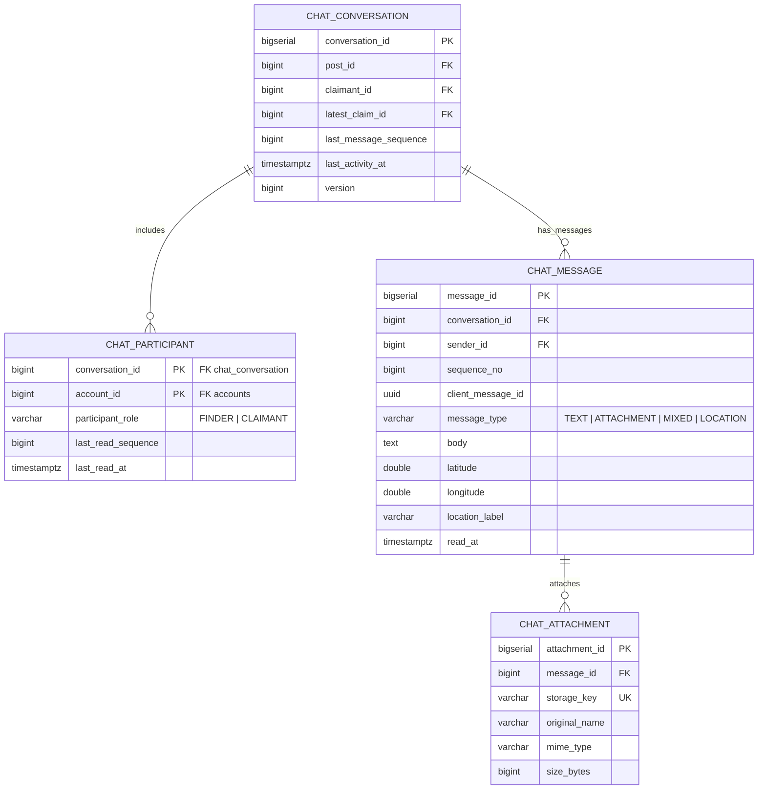
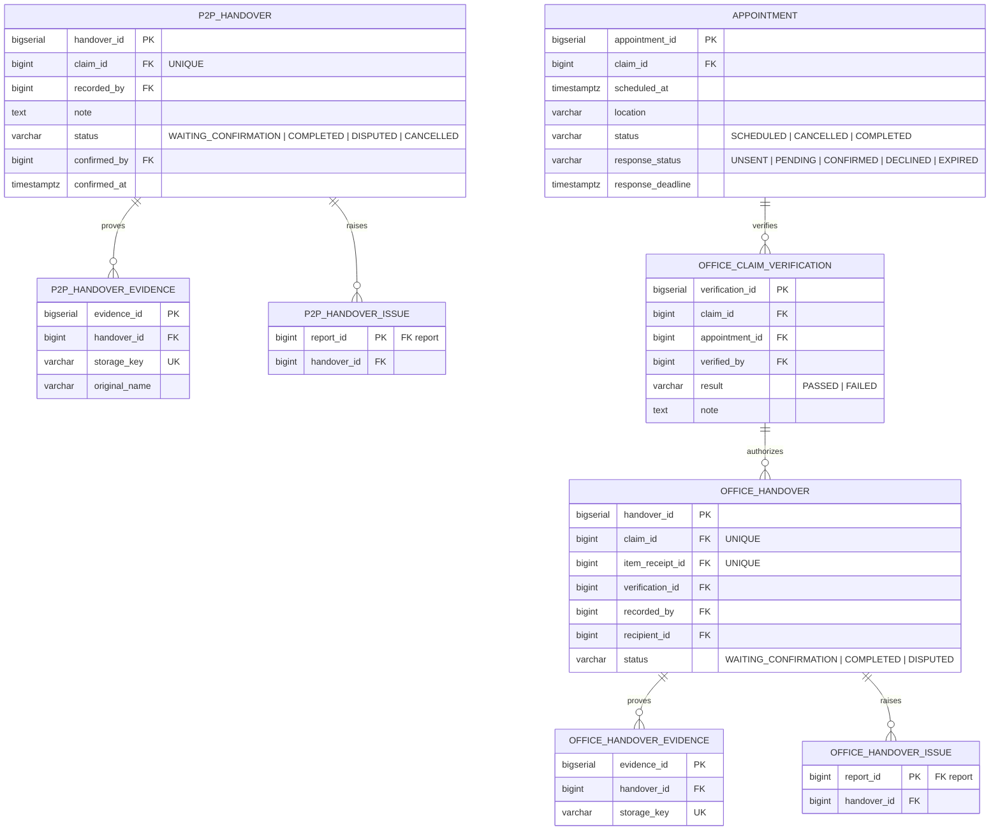
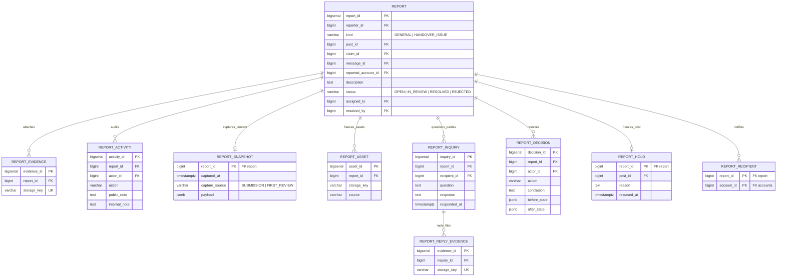
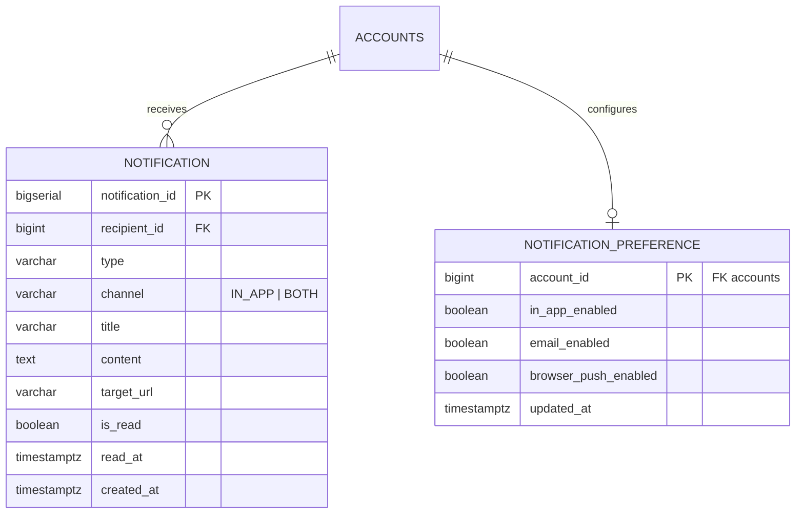

# 01. Thiết Kế Cơ Sở Dữ Liệu & Sơ Đồ ERD — Sagasu

⬅️ [Quay lại Trang chủ Kiến trúc](./README.md) | ➡️ [Xem tiếp: 02. Sơ đồ Tuần tự (Sequence Diagrams)](./02-sequence-diagrams.md)

---

## 1. Tổng Quan Cơ Sở Dữ Liệu

Hệ thống **Sagasu** sử dụng **PostgreSQL** làm hệ quản trị cơ sở dữ liệu quan hệ chính, kết hợp với:
- **Cloudflare R2 Object Storage**: Lưu trữ toàn bộ hình ảnh bài đăng, bằng chứng nhận đồ, tệp đính kèm chat, biên bản bàn giao và bằng chứng báo cáo thông qua khóa định danh duy nhất `storage_key`.
- **PostgreSQL Full-Text Search (`tsvector` + GIN Index)**: Đánh chỉ mục toàn văn trên tiêu đề, mô tả, địa điểm của bảng `post` phục vụ tìm kiếm nhanh và gợi ý bài đăng tương tự (Smart Matching).
- **Optimistic Locking (`version`)**: Kiểm soát truy cập đồng thời trên các thực thể có chuyển đổi trạng thái quan trọng (`claim`, `office_transfer`, `p2p_handover`, `office_handover`, `appointment`, `report`, `chat_conversation`).

---

## 2. Sơ Đồ ERD Tổng Thể (Full System ERD)

---

## 3. Chi Tiết Các Phân Hệ Cơ Sở Dữ Liệu

### 3.1. Phân hệ 1: Định danh, Xác thực & Kiểm toán (`4 bảng`)

| Bảng | Khóa chính (PK) | Khóa ngoại (FK) & Ràng buộc | Mô tả nghiệp vụ & Trạng thái |
| :--- | :--- | :--- | :--- |
| **`accounts`** | `id` (`BIGSERIAL`) | `created_by` -> `accounts(id)` `email` (`UNIQUE`, lưu chữ thường) | Lưu tài khoản người dùng và nhân sự. Tăng `failed_login_count` khi nhập sai mật khẩu; đạt 5 lần sẽ gán `locked_until` (+15 phút). |
| **`refresh_tokens`** | `id` (`BIGSERIAL`) | `account_id` -> `accounts(id)` (`CASCADE`) | Quản lý phiên đăng nhập dài hạn bằng mã băm SHA-256 (`token_hash`). |
| **`otp_challenges`** | `id` (`BIGSERIAL`) | `account_id` -> `accounts(id)` (`CASCADE`) | Quản lý mã OTP 6 chữ số cho luồng Quên mật khẩu (`FORGOT_PASSWORD`) và Đổi mật khẩu (`CHANGE_PASSWORD`). |
| **`login_audit_logs`** | `id` (`BIGSERIAL`) | `account_id` -> `accounts(id)` (`SET NULL`) | Ghi nhận nhật ký bảo mật mọi sự kiện đăng nhập, đổi mật khẩu, khóa tài khoản kèm IP và User-Agent. |

---

### 3.2. Phân hệ 2: Danh mục, Bài đăng & Gợi ý thông minh (`4 bảng`)

| Bảng | Khóa chính (PK) | Khóa ngoại (FK) & Ràng buộc | Mô tả nghiệp vụ & Trạng thái |
| :--- | :--- | :--- | :--- |
| **`category`** | `category_id` (`BIGSERIAL`) | `name` (`UNIQUE`) | Danh mục đồ vật (Ví/Giấy tờ, Điện thoại, Laptop, Chìa khóa, Thẻ sinh viên, Khác...). |
| **`post`** | `post_id` (`BIGSERIAL`) | `account_id`, `created_by`, `moderated_by` -> `accounts(id)` `category_id` -> `category(category_id)` | Bài đăng tin mất đồ (`LOST`) hoặc nhặt được đồ (`FOUND`). Có trường `private_identifiers` ẩn với công khai để đối chiếu khi duyệt Claim, và `search_document` (`tsvector`) phục vụ tìm kiếm & Smart Match. |
| **`post_image`** | `post_image_id` (`BIGSERIAL`) | `post_id` -> `post(post_id)` (`CASCADE`) `storage_key` (`UNIQUE`) | Lưu metadata và khóa `storage_key` trên Cloudflare R2 của các ảnh thuộc bài đăng (tối đa 5 ảnh/bài). |
| **`post_creation_request`** | `(account_id, request_id)` | `account_id` -> `accounts(id)` `post_id` -> `post(post_id)` | Bảng chống tạo trùng bài đăng (**Idempotency**) dựa trên header `X-Request-Id`. |

---

### 3.3. Phân hệ 3: Tiếp nhận Văn phòng, Kho lưu trữ & Chuyển giao (`5 bảng`)

| Bảng | Khóa chính (PK) | Khóa ngoại (FK) & Ràng buộc | Mô tả nghiệp vụ & Trạng thái |
| :--- | :--- | :--- | :--- |
| **`storage_location`** | `storage_location_id` (`BIGSERIAL`) | `parent_location_id` -> `storage_location` | Cây phân cấp vị trí kệ/tủ lưu trữ tại văn phòng (VD: Tủ A -> Ngăn 1). |
| **`item_receipt`** | `item_receipt_id` (`BIGSERIAL`) | `post_id` -> `post(post_id)` (`UNIQUE`) `storage_location_id` -> `storage_location` | Phiếu biên nhận lưu kho văn phòng (nhận trực tiếp tại quầy `WALK_IN` hoặc chuyển từ bài đăng `EXISTING_POST`). |
| **`item_receipt_image`** | `item_receipt_image_id` (`BIGSERIAL`) | `item_receipt_id` -> `item_receipt` (`CASCADE`) | Hình ảnh chụp vật phẩm lúc tiếp nhận vào kho, hỗ trợ cờ `is_sensitive` để che thông tin nhạy cảm. |
| **`office_transfer`** | `transfer_id` (`BIGSERIAL`) | `post_id` -> `post(post_id)` `item_receipt_id` -> `item_receipt` | Yêu cầu chuyển quyền giữ đồ từ người nhặt (P2P) sang Văn phòng (`OFFICE`). |
| **`office_intake_appointment`** | `appointment_id` (`BIGSERIAL`) | `transfer_id` -> `office_transfer` (`CASCADE`) | Lịch hẹn người nhặt mang đồ tới nộp cho Văn phòng, có gửi email kèm link xác nhận trong hạn 12 giờ (`response_deadline`). |

---

### 3.4. Phân hệ 4: Yêu cầu nhận đồ & Bộ câu hỏi xác minh (`6 bảng`)

| Bảng | Khóa chính (PK) | Khóa ngoại (FK) & Ràng buộc | Mô tả nghiệp vụ & Trạng thái |
| :--- | :--- | :--- | :--- |
| **`claim_question_template`** | `template_id` (`BIGSERIAL`) | `category_name` (`UNIQUE`) `template_code` (`UNIQUE`) | Mẫu bộ câu hỏi xác minh quyền sở hữu tương ứng với từng danh mục đồ vật. |
| **`claim_question`** | `question_id` (`BIGSERIAL`) | `template_id` -> `claim_question_template` | Chi tiết từng câu hỏi trong bộ mẫu (nhãn câu hỏi, gợi ý, bắt buộc hay không, độ dài tối đa). |
| **`claim`** | `claim_id` (`BIGSERIAL`) | `post_id` -> `post(post_id)` `claimant_id` -> `accounts(id)` `item_receipt_id` -> `item_receipt` | Phiếu yêu cầu nhận lại đồ (hỗ trợ cả luồng tự trao trả `P2P` và luồng nhận tại văn phòng `OFFICE`). |
| **`claim_answer`** | `claim_answer_id` (`BIGSERIAL`) | `claim_id` -> `claim(claim_id)` (`CASCADE`) | Lưu bản chụp (snapshot) câu hỏi và câu trả lời của người nhận tại thời điểm nộp Claim. |
| **`claim_evidence`** | `claim_evidence_id` (`BIGSERIAL`) | `claim_id` -> `claim(claim_id)` (`CASCADE`) | Tệp ảnh/tài liệu bằng chứng đính kèm theo Claim (kiểm tra trùng bằng `content_hash` SHA-256). |
| **`claim_activity`** | `claim_activity_id` (`BIGSERIAL`) | `claim_id` -> `claim(claim_id)` (`CASCADE`) | Nhật ký toàn bộ vòng đời chuyển trạng thái của Claim (`SUBMIT`, `REQUEST_INFO`, `RESUBMIT`, `APPROVE`, `REJECT`, `HANDOVER`, `AUTO_CLOSE`...). |

---

### 3.5. Phân hệ 5: Trò chuyện trực tuyến P2P (`4 bảng`)

| Bảng | Khóa chính (PK) | Khóa ngoại (FK) & Ràng buộc | Mô tả nghiệp vụ & Trạng thái |
| :--- | :--- | :--- | :--- |
| **`chat_conversation`** | `conversation_id` (`BIGSERIAL`) | `post_id` -> `post`, `claimant_id` -> `accounts`, `latest_claim_id` -> `claim` `UNIQUE(post_id, claimant_id)` | Phòng trò chuyện giữa Người nhặt (Finder) và Người nhận (Claimant) sau khi Claim được duyệt. |
| **`chat_participant`** | `(conversation_id, account_id)` | `conversation_id` -> `chat_conversation` `account_id` -> `accounts(id)` | Thành viên trong cuộc hội thoại và vị trí tin nhắn đã đọc gần nhất (`last_read_sequence`). |
| **`chat_message`** | `message_id` (`BIGSERIAL`) | `(conversation_id, sender_id)` -> `chat_participant` | Tin nhắn hỗ trợ 4 định dạng: Văn bản (`TEXT`), Đính kèm (`ATTACHMENT`), Kết hợp (`MIXED`), và Chia sẻ vị trí bản đồ (`LOCATION`). |
| **`chat_attachment`** | `attachment_id` (`BIGSERIAL`) | `message_id` -> `chat_message` (`CASCADE`) | Tệp ảnh/PDF đính kèm trong tin nhắn chat lưu trên Cloudflare R2. |

---

### 3.6. Phân hệ 6: Bàn giao đồ P2P & Trao trả tại Văn phòng (`8 bảng`)

| Bảng | Khóa chính (PK) | Khóa ngoại (FK) & Ràng buộc | Mô tả nghiệp vụ & Trạng thái |
| :--- | :--- | :--- | :--- |
| **`p2p_handover`** | `handover_id` (`BIGSERIAL`) | `claim_id` -> `claim(claim_id)` (`UNIQUE`) | Biên bản bàn giao trực tiếp giữa 2 người dùng (`WAITING_CONFIRMATION` -> `COMPLETED` hoặc `DISPUTED`). |
| **`p2p_handover_evidence`** | `evidence_id` (`BIGSERIAL`) | `handover_id` -> `p2p_handover` (`CASCADE`) | Ảnh chụp minh chứng lúc bàn giao P2P. |
| **`p2p_handover_issue`** | `report_id` (`BIGINT`) | `report_id` -> `report`, `handover_id` -> `p2p_handover` | Liên kết biên bản bàn giao P2P bị khiếu nại với phiếu Báo cáo sự cố (`HANDOVER_ISSUE`). |
| **`appointment`** | `appointment_id` (`BIGSERIAL`) | `claim_id` -> `claim(claim_id)` (`CASCADE`) | Lịch hẹn người nhận đến Văn phòng nhận lại đồ (gửi email xác nhận hạn 12 giờ). |
| **`office_claim_verification`** | `verification_id` (`BIGSERIAL`) | `claim_id` -> `claim`, `appointment_id` -> `appointment` | Kết quả kiểm tra đối chiếu giấy tờ/vật phẩm trực tiếp tại quầy (`PASSED` / `FAILED`). |
| **`office_handover`** | `handover_id` (`BIGSERIAL`) | `claim_id` (`UNIQUE`), `item_receipt_id` (`UNIQUE`), `verification_id` | Biên bản xuất kho trao trả đồ tại Văn phòng. |
| **`office_handover_evidence`** | `evidence_id` (`BIGSERIAL`) | `handover_id` -> `office_handover` (`CASCADE`) | Ảnh chụp biên bản/minh chứng trao trả tại quầy Văn phòng. |
| **`office_handover_issue`** | `report_id` (`BIGINT`) | `report_id` -> `report`, `handover_id` -> `office_handover` | Liên kết sự cố trao trả tại Văn phòng với phiếu `report`. |

---

### 3.7. Phân hệ 7: Báo cáo vi phạm, Điều tra & Giải quyết tranh chấp (`10 bảng`)

| Bảng | Khóa chính (PK) | Khóa ngoại (FK) & Ràng buộc | Mô tả nghiệp vụ & Trạng thái |
| :--- | :--- | :--- | :--- |
| **`report`** | `report_id` (`BIGSERIAL`) | `reporter_id`, `reported_account_id`, `assigned_to`, `resolved_by` -> `accounts` | Phiếu báo cáo vi phạm (`GENERAL`) hoặc khiếu nại bàn giao (`HANDOVER_ISSUE`). |
| **`report_evidence`** | `evidence_id` (`BIGSERIAL`) | `report_id` -> `report(report_id)` (`CASCADE`) | Tệp bằng chứng do người báo cáo tải lên khi gửi phiếu. |
| **`report_activity`** | `activity_id` (`BIGSERIAL`) | `report_id` -> `report(report_id)` (`CASCADE`) | Nhật ký điều tra của Manager (hỗ trợ cả ghi chú công khai `public_note` và ghi chú nội bộ `internal_note`). |
| **`report_snapshot`** | `report_id` (`BIGINT`) | `report_id` -> `report(report_id)` (`CASCADE`) | Bản chụp nguyên trạng dữ liệu (`JSONB`) của Bài đăng, Claim, Chat, Handover tại thời điểm nộp báo cáo để chống sửa đổi/phi tang. |
| **`report_asset`** | `asset_id` (`BIGSERIAL`) | `report_id` -> `report(report_id)` (`CASCADE`) | Danh sách các tệp ảnh/tài liệu liên quan được đóng băng cùng hồ sơ báo cáo. |
| **`report_inquiry`** | `inquiry_id` (`BIGSERIAL`) | `report_id` -> `report`, `recipient_id` -> `accounts` | Câu hỏi xác minh của Manager gửi cho người báo cáo hoặc người bị báo cáo và nội dung phản hồi. |
| **`report_reply_evidence`** | `evidence_id` (`BIGSERIAL`) | `inquiry_id` -> `report_inquiry` (`CASCADE`) | Tệp bằng chứng người dùng đính kèm khi trả lời câu hỏi điều tra của Manager. |
| **`report_decision`** | `decision_id` (`BIGSERIAL`) | `report_id` -> `report`, `actor_id` -> `accounts` | Quyết định xử lý cuối cùng của Manager, lưu lại trạng thái trước (`before_state`) và sau (`after_state`) khi áp dụng chế tài. |
| **`report_hold`** | `report_id` (`BIGINT`) | `report_id` -> `report`, `post_id` -> `post` | Lệnh phong tỏa tạm thời bài đăng đang bị điều tra (`ReportHoldGuard`). |
| **`report_recipient`** | `(report_id, account_id)` | `report_id` -> `report`, `account_id` -> `accounts` | Danh sách người dùng nhận thông báo kết luận giải quyết báo cáo. |

---

### 3.8. Phân hệ 8: Thông báo đa kênh & Tùy chọn người dùng (`2 bảng`)

| Bảng | Khóa chính (PK) | Khóa ngoại (FK) & Ràng buộc | Mô tả nghiệp vụ & Trạng thái |
| :--- | :--- | :--- | :--- |
| **`notification`** | `notification_id` (`BIGSERIAL`) | `recipient_id` -> `accounts(id)` (`CASCADE`) | Lưu thông báo trong ứng dụng (`IN_APP`) hoặc kết hợp gửi Email (`BOTH`) kèm đường dẫn điều hướng `target_url`. |
| **`notification_preference`** | `account_id` (`BIGINT`) | `account_id` -> `accounts(id)` (`CASCADE`) | Cho phép người dùng chủ động bật/tắt từng kênh thông báo: Trong web (`in_app_enabled`), Email (`email_enabled`), và Thông báo trình duyệt (`browser_push_enabled`). |

---

⬅️ [Quay lại Trang chủ Kiến trúc](./README.md) | ➡️ [Xem tiếp: 02. Sơ đồ Tuần tự (Sequence Diagrams)](./02-sequence-diagrams.md)
