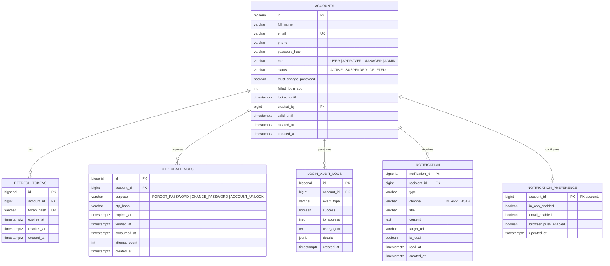
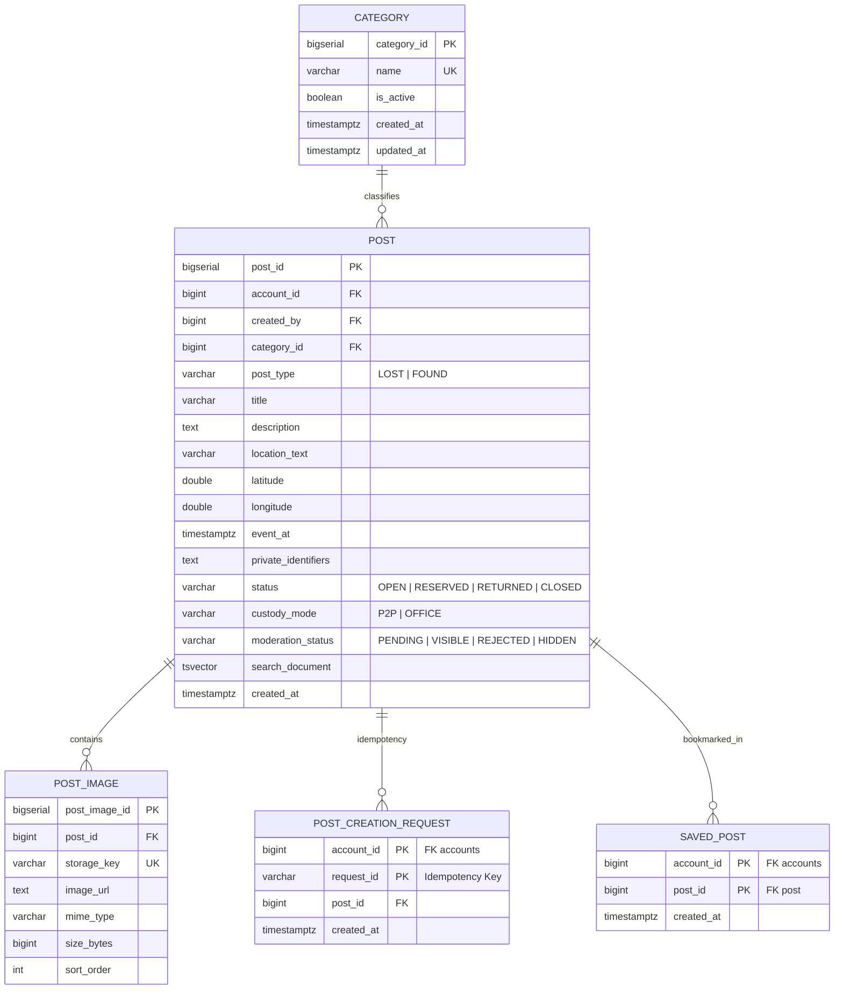
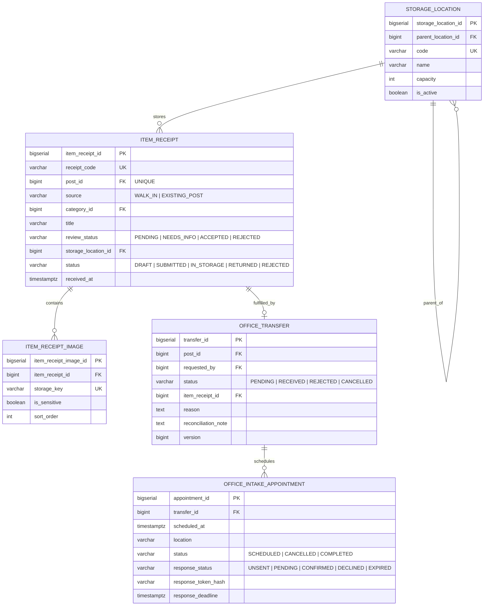
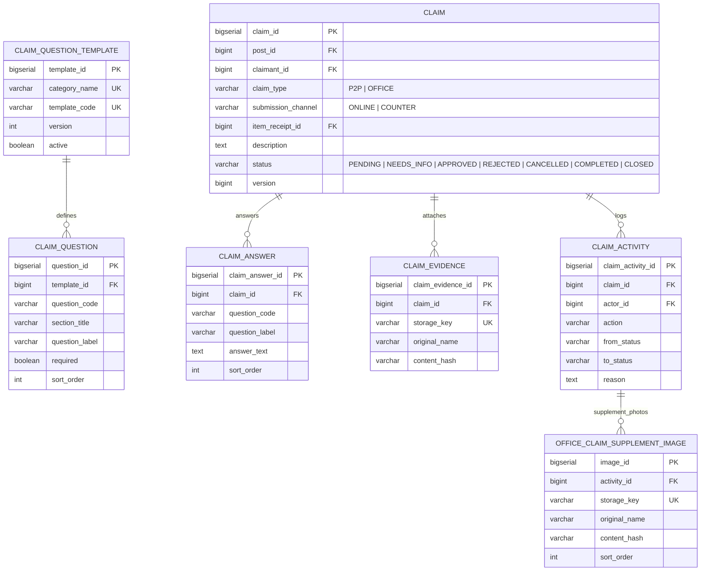
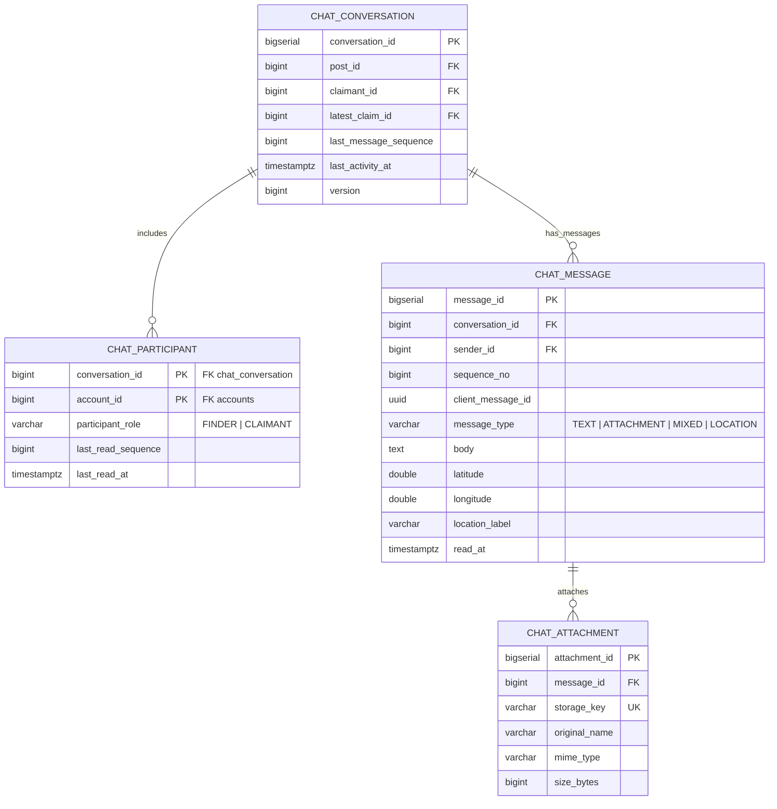
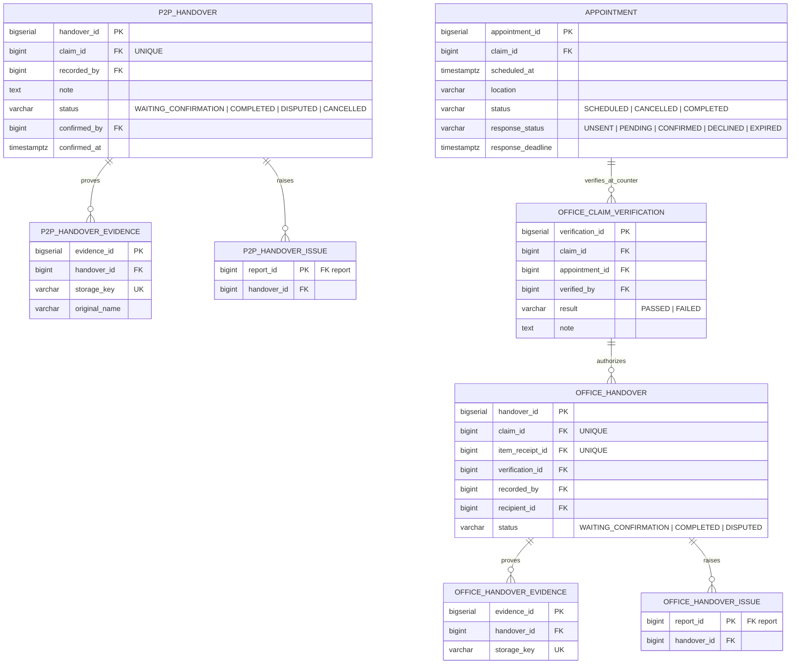
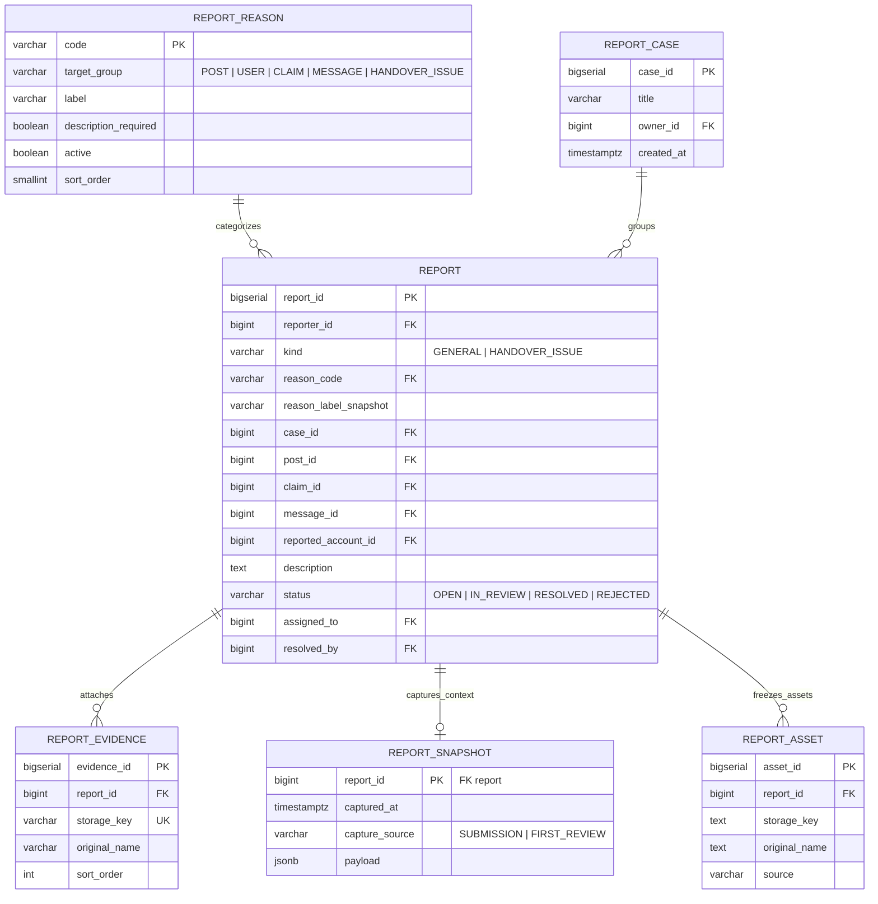
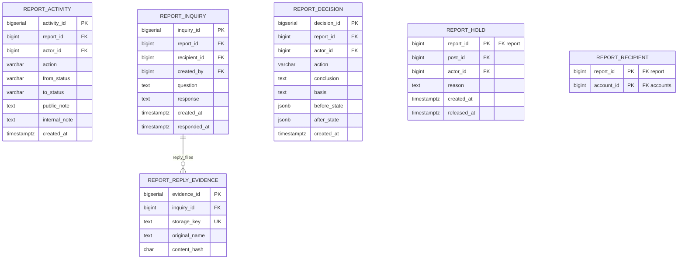

# 01. Thiết Kế Cơ Sở Dữ Liệu & Sơ Đồ ERD Theo 8 Module Trung Bình (47 Bảng) — Sagasu

⬅️ [Quay lại Trang chủ Kiến trúc](./README.md) | ➡️ [Xem tiếp: 02. Sơ đồ Tuần tự (Sequence Diagrams)](./02-sequence-diagrams.md)

---

## 1. Tổng Quan & Thống Kê Số Lượng Bảng (43 -> 47 Bảng)

Hệ thống **Sagasu** hiện có tổng cộng **47 bảng vật lý** trong PostgreSQL (tăng thêm **4 bảng mới** so với mốc 43 bảng trước đây):
1. **`report_reason`** *(Mới - Migration 23)*: Danh mục lý do báo cáo vi phạm & sự cố bàn giao (hỗ trợ CRUD bởi Admin/Manager).
2. **`office_claim_supplement_image`** *(Mới - Migration 24)*: Ảnh bằng chứng đính kèm theo từng lần bổ sung thông tin (`RESUBMIT`) cho hồ sơ Claim Văn phòng.
3. **`report_case`** *(Mới - Migration 24)*: Hồ sơ vụ việc gom nhóm các báo cáo cùng đối tượng/sự việc để Manager điều tra.
4. **`saved_post`** *(Mới - Migration 26)*: Danh sách bài đăng đã lưu (Bookmark) theo từng tài khoản người dùng.

Để sơ đồ thiết kế ERD rõ ràng, dễ nhìn trong báo cáo và slide bảo vệ (trung bình **4 – 8 bảng / sơ đồ**), toàn bộ **47 bảng** được chia đều thành **8 Module Thiết kế Trung bình**:

| STT | Tên Module Thiết Kế (ERD) | Số bảng | Thực thể trung tâm (Core Entity) | Danh sách các bảng trong Module |
| :-: | :--- | :-: | :--- | :--- |
| **M01** | **Định danh, Xác thực, Kiểm toán & Thông báo** | **6** | `accounts` | `accounts`, `refresh_tokens`, `otp_challenges`, `login_audit_logs`, `notification`, `notification_preference` |
| **M02** | **Danh mục, Bài đăng & Bài đăng đã lưu** | **5** | `post` | `category`, `post`, `post_image`, `post_creation_request`, `saved_post` *(mới)* |
| **M03** | **Tiếp nhận Văn phòng, Kho lưu trữ & Chuyển giao** | **5** | `item_receipt` | `storage_location`, `item_receipt`, `item_receipt_image`, `office_transfer`, `office_intake_appointment` |
| **M04** | **Yêu cầu Nhận đồ (Claims) & Bộ câu hỏi Xác minh** | **7** | `claim` | `claim_question_template`, `claim_question`, `claim`, `claim_answer`, `claim_evidence`, `claim_activity`, `office_claim_supplement_image` *(mới)* |
| **M05** | **Trò chuyện Trực tuyến P2P & Chia sẻ Vị trí** | **4** | `chat_conversation` | `chat_conversation`, `chat_participant`, `chat_message`, `chat_attachment` |
| **M06** | **Lịch hẹn, Xác minh tại quầy & Bàn giao (P2P + Office)** | **8** | `p2p_handover` & `office_handover` | `p2p_handover`, `p2p_handover_evidence`, `p2p_handover_issue`, `appointment`, `office_claim_verification`, `office_handover`, `office_handover_evidence`, `office_handover_issue` |
| **M07** | **Báo cáo Vi phạm, Lý do & Đóng băng Ngữ cảnh** | **6** | `report` | `report_reason` *(mới)*, `report_case` *(mới)*, `report`, `report_evidence`, `report_snapshot`, `report_asset` |
| **M08** | **Điều tra Báo cáo, Giải trình & Phán quyết (Manager)** | **6** | `report` (Investigation) | `report_activity`, `report_inquiry`, `report_reply_evidence`, `report_decision`, `report_hold`, `report_recipient` |
| **Tổng** | **8 Module Thiết kế Cân đối** | **47 bảng** | — | Trung bình **~5.9 bảng / module** (rất thoáng khi vẽ ERD) |

---

## 2. Chi Tiết Thiết Kế ERD Từng Module (8 Module)

### 2.1. Module 1: Định danh, Xác thực, Kiểm toán & Thông báo (`6 bảng`)
> **Gợi ý bố cục vẽ**: Đặt bảng `accounts` ở chính giữa; 3 bảng xác thực/kiểm toán (`refresh_tokens`, `otp_challenges`, `login_audit_logs`) ở nhánh trái và 2 bảng thông báo (`notification`, `notification_preference`) ở nhánh phải.

| STT | Tên bảng | Khóa chính (PK) | Khóa ngoại (FK) | Vai trò trong Module 1 |
| :-: | :--- | :--- | :--- | :--- |
| 1 | **`accounts`** | `id` | `created_by` -> `accounts(id)` | Lưu tài khoản người dùng & nhân sự, phân quyền Role và khóa tạm thời khi sai mật khẩu 5 lần. |
| 2 | **`refresh_tokens`** | `id` | `account_id` -> `accounts(id)` | Quản lý phiên đăng nhập JWT Refresh Token bằng mã băm SHA-256. |
| 3 | **`otp_challenges`** | `id` | `account_id` -> `accounts(id)` | Lưu mã OTP 6 số có thời hạn cho luồng Quên mật khẩu & Mở khóa tài khoản. |
| 4 | **`login_audit_logs`** | `id` | `account_id` -> `accounts(id)` | Nhật ký bảo mật & kiểm toán đăng nhập, đổi mật khẩu, cập nhật hồ sơ kèm IP/User-Agent. |
| 5 | **`notification`** | `notification_id` | `recipient_id` -> `accounts(id)` | Lưu thông báo đa kênh (In-App & Email) gửi tới từng tài khoản. |
| 6 | **`notification_preference`** | `account_id` | `account_id` -> `accounts(id)` | Cài đặt bật/tắt kênh thông báo cá nhân (In-App, Email, Browser Push). |

---

### 2.2. Module 2: Danh mục, Bài đăng & Bài đăng đã lưu (`5 bảng`)
> **Gợi ý bố cục vẽ**: Đặt bảng `post` ở trung tâm; phía trên là `category`, bên dưới là `post_image`, hai bên là `post_creation_request` và `saved_post`.

| STT | Tên bảng | Khóa chính (PK) | Khóa ngoại (FK) | Vai trò trong Module 2 |
| :-: | :--- | :--- | :--- | :--- |
| 7 | **`category`** | `category_id` | — | Danh mục phân loại đồ thất lạc (Ví, Điện thoại, Laptop, Thẻ sinh viên...). |
| 8 | **`post`** | `post_id` | `account_id`, `category_id` | Bài đăng tin mất đồ (`LOST`) và nhặt được đồ (`FOUND`), tích hợp `tsvector` cho tìm kiếm & AI Smart Match. |
| 9 | **`post_image`** | `post_image_id` | `post_id` -> `post(post_id)` | Danh sách hình ảnh đính kèm của bài đăng lưu trên Cloudflare R2 (tối đa 5 ảnh). |
| 10 | **`post_creation_request`** | `(account_id, request_id)` | `account_id`, `post_id` | Đảm bảo tính Idempotency chống tạo trùng bài đăng khi mạng chập chờn. |
| 11 | **`saved_post`** *(Mới)* | `(account_id, post_id)` | `account_id`, `post_id` | Lưu danh sách bài đăng được người dùng đánh dấu quan tâm (Bookmark). |

---

### 2.3. Module 3: Tiếp nhận Văn phòng, Kho lưu trữ & Chuyển giao (`5 bảng`)
> **Gợi ý bố cục vẽ**: Đặt `item_receipt` ở giữa; bên trái là `storage_location` (có mũi tên tự tham chiếu cha-con) và `item_receipt_image`; bên phải là `office_transfer` và `office_intake_appointment`.

| STT | Tên bảng | Khóa chính (PK) | Khóa ngoại (FK) | Vai trò trong Module 3 |
| :-: | :--- | :--- | :--- | :--- |
| 12 | **`storage_location`** | `storage_location_id` | `parent_location_id` | Cây phân cấp vị trí kệ, tủ, ngăn lưu trữ vật phẩm tại văn phòng. |
| 13 | **`item_receipt`** | `item_receipt_id` | `post_id`, `storage_location_id` | Phiếu biên nhận lưu kho văn phòng (tiếp nhận trực tiếp tại quầy hoặc nhận từ bài đăng P2P). |
| 14 | **`item_receipt_image`** | `item_receipt_image_id` | `item_receipt_id` | Ảnh chụp vật phẩm khi văn phòng tiếp nhận vào kho (hỗ trợ đánh dấu ảnh nhạy cảm `is_sensitive`). |
| 15 | **`office_transfer`** | `transfer_id` | `post_id`, `item_receipt_id` | Yêu cầu chuyển quyền giữ đồ từ người nhặt (P2P) sang kho Văn phòng. |
| 16 | **`office_intake_appointment`** | `appointment_id` | `transfer_id` | Lịch hẹn mời người nhặt mang đồ đến nộp tại Văn phòng kèm token xác nhận qua Email trong 12 giờ. |

---

### 2.4. Module 4: Yêu cầu Nhận đồ (Claims) & Bộ câu hỏi Xác minh (`7 bảng`)
> **Gợi ý bố cục vẽ**: Phía trên là cụm cấu hình câu hỏi (`claim_question_template` -> `claim_question`); ở giữa là bảng `claim`; bên dưới là 4 bảng hồ sơ chi tiết (`claim_answer`, `claim_evidence`, `claim_activity` -> `office_claim_supplement_image`).

| STT | Tên bảng | Khóa chính (PK) | Khóa ngoại (FK) | Vai trò trong Module 4 |
| :-: | :--- | :--- | :--- | :--- |
| 17 | **`claim_question_template`** | `template_id` | — | Mẫu bộ câu hỏi xác minh quyền sở hữu theo danh mục đồ vật. |
| 18 | **`claim_question`** | `question_id` | `template_id` | Danh sách câu hỏi thành phần trong từng mẫu questionnaire. |
| 19 | **`claim`** | `claim_id` | `post_id`, `claimant_id`, `item_receipt_id` | Hồ sơ yêu cầu nhận lại đồ (dùng chung cho cả luồng P2P và Văn phòng). |
| 20 | **`claim_answer`** | `claim_answer_id` | `claim_id` -> `claim(claim_id)` | Bản chụp (Snapshot) câu hỏi và câu trả lời xác minh khi nộp Claim. |
| 21 | **`claim_evidence`** | `claim_evidence_id` | `claim_id` -> `claim(claim_id)` | Ảnh bằng chứng ban đầu người nhận đính kèm khi tạo Claim. |
| 22 | **`claim_activity`** | `claim_activity_id` | `claim_id`, `actor_id` | Nhật ký toàn bộ quá trình xét duyệt, yêu cầu bổ sung, thu hồi duyệt hoặc đóng Claim. |
| 23 | **`office_claim_supplement_image`** *(Mới)* | `image_id` | `activity_id` -> `claim_activity` | Ảnh bằng chứng bổ sung gắn với từng lần người nhận phản hồi yêu cầu bổ sung (`RESUBMIT`) tại Văn phòng. |

---

### 2.5. Module 5: Trò chuyện Trực tuyến P2P & Chia sẻ Vị trí (`4 bảng`)
> **Gợi ý bố cục vẽ**: Chuỗi tuyến tính từ trái sang phải hoặc trên xuống dưới: `chat_conversation` -> `chat_participant` -> `chat_message` -> `chat_attachment`.

| STT | Tên bảng | Khóa chính (PK) | Khóa ngoại (FK) | Vai trò trong Module 5 |
| :-: | :--- | :--- | :--- | :--- |
| 24 | **`chat_conversation`** | `conversation_id` | `post_id`, `claimant_id`, `latest_claim_id` | Phòng trò chuyện P2P mở tự động khi chủ bài đăng duyệt Claim. |
| 25 | **`chat_participant`** | `(conversation_id, account_id)` | `conversation_id`, `account_id` | Thành viên phòng chat (`FINDER` / `CLAIMANT`) và mốc đọc tin nhắn (`last_read_sequence`). |
| 26 | **`chat_message`** | `message_id` | `(conversation_id, sender_id)` | Tin nhắn thời gian thực (Văn bản, Đính kèm, Kết hợp hoặc Tọa độ vị trí hẹn gặp). |
| 27 | **`chat_attachment`** | `attachment_id` | `message_id` -> `chat_message` | Tệp hình ảnh/tài liệu đính kèm trong tin nhắn. |

---

### 2.6. Module 6: Lịch hẹn, Xác minh tại quầy & Bàn giao Tài sản (`8 bảng`)
> **Gợi ý bố cục vẽ**: Chia sơ đồ thành 2 làn song song đối xứng qua bảng `claim`:
> - **Làn trên (Bàn giao P2P - 3 bảng)**: `p2p_handover` -> `p2p_handover_evidence` & `p2p_handover_issue`.
> - **Làn dưới (Trao trả tại Văn phòng - 5 bảng)**: `appointment` -> `office_claim_verification` -> `office_handover` -> `office_handover_evidence` & `office_handover_issue`.

| STT | Tên bảng | Khóa chính (PK) | Khóa ngoại (FK) | Vai trò trong Module 6 |
| :-: | :--- | :--- | :--- | :--- |
| 28 | **`p2p_handover`** | `handover_id` | `claim_id` (`UNIQUE`) | Biên bản bàn giao đồ trực tiếp giữa Người nhặt và Người nhận. |
| 29 | **`p2p_handover_evidence`** | `evidence_id` | `handover_id` -> `p2p_handover` | Ảnh chụp minh chứng lúc bàn giao trực tiếp P2P. |
| 30 | **`p2p_handover_issue`** | `report_id` | `report_id`, `handover_id` | Liên kết sự cố bàn giao P2P với phiếu khiếu nại `report`. |
| 31 | **`appointment`** | `appointment_id` | `claim_id` -> `claim(claim_id)` | Lịch hẹn người nhận đến Văn phòng nhận lại đồ (xác nhận qua Email 12h). |
| 32 | **`office_claim_verification`** | `verification_id` | `claim_id`, `appointment_id` | Biên bản kiểm tra giấy tờ tùy thân & đối chiếu vật phẩm tại quầy (`PASSED` / `FAILED`). |
| 33 | **`office_handover`** | `handover_id` | `claim_id`, `item_receipt_id`, `verification_id` | Biên bản xuất kho trao trả đồ tại quầy Văn phòng. |
| 34 | **`office_handover_evidence`** | `evidence_id` | `handover_id` -> `office_handover` | Ảnh chụp biên bản/minh chứng trao trả tại Văn phòng. |
| 35 | **`office_handover_issue`** | `report_id` | `report_id`, `handover_id` | Liên kết sự cố trao trả tại Văn phòng với phiếu khiếu nại `report`. |

---

### 2.7. Module 7: Báo cáo Vi phạm, Lý do & Đóng băng Ngữ cảnh (`6 bảng`)
> **Gợi ý bố cục vẽ**: Đặt `report` ở giữa; phía trên là 2 bảng phân loại (`report_reason`, `report_case`); phía dưới là 3 bảng lưu trữ bằng chứng và chụp nguyên trạng ngữ cảnh (`report_evidence`, `report_snapshot`, `report_asset`).

| STT | Tên bảng | Khóa chính (PK) | Khóa ngoại (FK) | Vai trò trong Module 7 |
| :-: | :--- | :--- | :--- | :--- |
| 36 | **`report_reason`** *(Mới)* | `code` (`VARCHAR`) | — | Danh mục chuẩn hóa các lý do báo cáo theo nhóm đối tượng (`POST`, `USER`, `CLAIM`, `MESSAGE`, `HANDOVER_ISSUE`). |
| 37 | **`report_case`** *(Mới)* | `case_id` | `owner_id` -> `accounts(id)` | Hồ sơ vụ việc gom nhóm các báo cáo có cùng đối tượng bị phản ánh. |
| 38 | **`report`** | `report_id` | `reason_code`, `case_id`, `post_id`, `claim_id`, `message_id`, `reported_account_id` | Phiếu báo cáo vi phạm hoặc sự cố bàn giao kèm bản chụp tên lý do `reason_label_snapshot`. |
| 39 | **`report_evidence`** | `evidence_id` | `report_id` -> `report(report_id)` | Ảnh bằng chứng do người báo cáo tải lên khi gửi phiếu. |
| 40 | **`report_snapshot`** | `report_id` | `report_id` -> `report(report_id)` | Bản chụp `JSONB` toàn bộ ngữ cảnh (Bài đăng, Claim, Chat, Handover) lúc báo cáo để chống sửa đổi/phi tang. |
| 41 | **`report_asset`** | `asset_id` | `report_id` -> `report(report_id)` | Đóng băng các khóa tệp hình ảnh/tài liệu trên R2 liên quan tới báo cáo để không bị xóa khi chủ bài sửa/xóa bài. |

---

### 2.8. Module 8: Điều tra Báo cáo, Giải trình & Phán quyết của Manager (`6 bảng`)
> **Gợi ý bố cục vẽ**: Lấy bảng `report` (từ Module 7) làm gốc tham chiếu, nối tỏa ra 6 bảng quy trình điều tra của Manager: Hỏi đáp giải trình (`report_inquiry` -> `report_reply_evidence`), Phong tỏa giao nhận (`report_hold`), Nhật ký điều tra (`report_activity`), Phán quyết (`report_decision`) và Người nhận kết quả (`report_recipient`).

| STT | Tên bảng | Khóa chính (PK) | Khóa ngoại (FK) | Vai trò trong Module 8 |
| :-: | :--- | :--- | :--- | :--- |
| 42 | **`report_activity`** | `activity_id` | `report_id`, `actor_id` | Nhật ký tiến trình điều tra của Manager (lưu cả ghi chú công khai `public_note` và nội bộ `internal_note`). |
| 43 | **`report_inquiry`** | `inquiry_id` | `report_id`, `recipient_id`, `created_by` | Câu hỏi yêu cầu giải trình Manager gửi tới các bên liên quan và nội dung trả lời. |
| 44 | **`report_reply_evidence`** | `evidence_id` | `inquiry_id` -> `report_inquiry` | Ảnh bằng chứng người dùng đính kèm khi phản hồi yêu cầu giải trình của Manager. |
| 45 | **`report_decision`** | `decision_id` | `report_id`, `actor_id` | Quyết định xử lý chính thức của Manager, lưu trạng thái trước (`before_state`) và sau (`after_state`) khi áp dụng chế tài. |
| 46 | **`report_hold`** | `report_id` | `report_id`, `post_id`, `actor_id` | Lệnh tạm dừng mọi thao tác giao nhận/chuyển giao trên bài đăng đang bị điều tra (`ReportHoldGuard`). |
| 47 | **`report_recipient`** | `(report_id, account_id)` | `report_id`, `account_id` | Danh sách các tài khoản liên quan được nhận thông báo và xem kết luận giải quyết báo cáo. |

---

⬅️ [Quay lại Trang chủ Kiến trúc](./README.md) | ➡️ [Xem tiếp: 02. Sơ đồ Tuần tự (Sequence Diagrams)](./02-sequence-diagrams.md)
