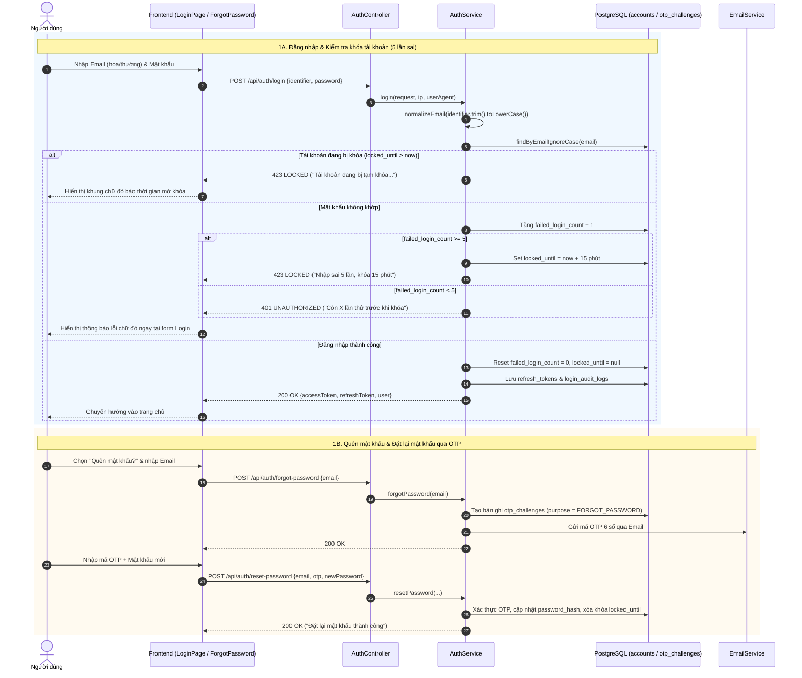
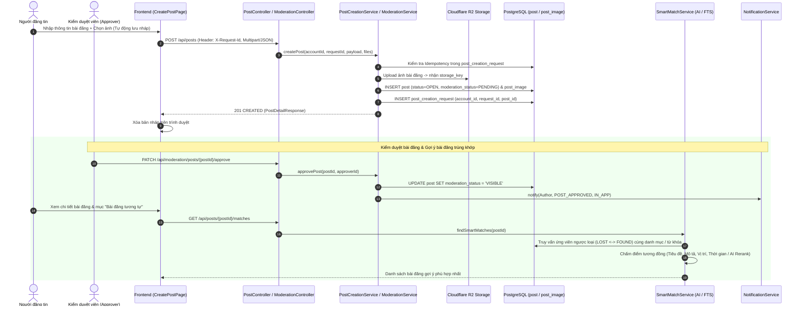
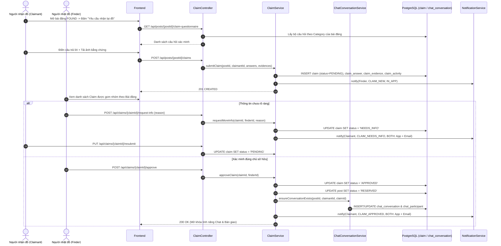
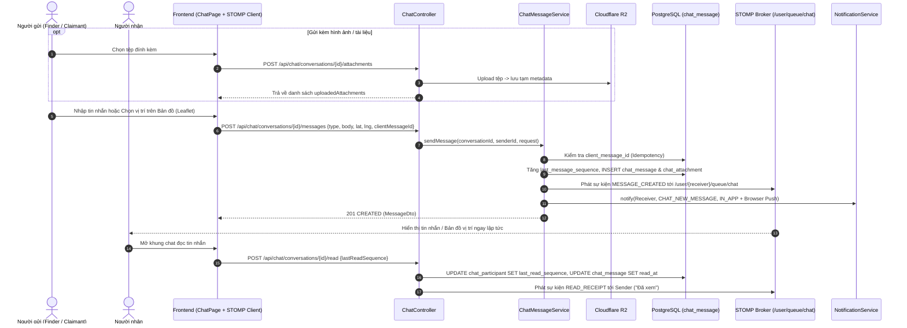
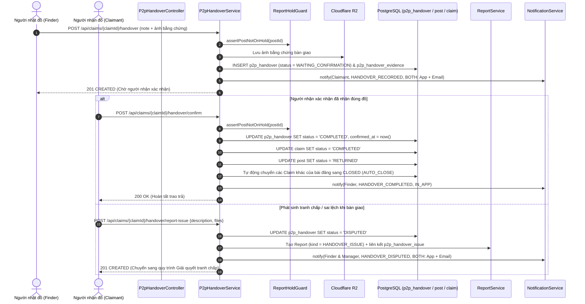
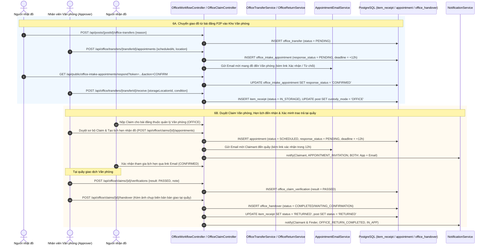
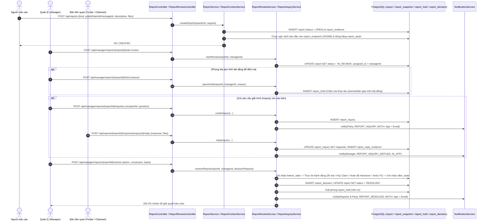

# 02. Sơ Đồ Tuần Tự (Sequence Diagrams) Các Luồng Nghiệp Vụ Chính — Sagasu

⬅️ [Xem trước: 01. Thiết kế Cơ sở dữ liệu & ERD](./01-database-schema.md) | 🏠 [Trang chủ Kiến trúc](./README.md) | ➡️ [Xem tiếp: 03. Tài liệu Tổng hợp](./03-full-overview.md)

---

## Mục Lục Nhanh Các Luồng Nghiệp Vụ

1. [Luồng 1: Đăng nhập (Chuẩn hóa Email, Khóa sau 5 lần sai) & Quên mật khẩu qua OTP](#luồng-1-đăng-nhập-tự-động-chuẩn-hóa-email-khóa-sau-5-lần-sai--quên-mật-khẩu-qua-otp)
2. [Luồng 2: Đăng tin Đồ thất lạc / Nhặt được, Kiểm duyệt & Gợi ý Thông minh (Smart Match AI)](#luồng-2-đăng-tin-đồ-thất-lạc--nhặt-được-kiểm-duyệt--gợi-ý-thông-minh-smart-match-ai)
3. [Luồng 3: Xác minh quyền sở hữu P2P (Submit Claim + Questionnaire) & Mở phòng Chat](#luồng-3-xác-minh-quyền-sở-hữu-p2p-submit-claim--questionnaire--mở-phòng-chat)
4. [Luồng 4: Trò chuyện P2P thời gian thực (Text, Tệp đính kèm, Vị trí bản đồ & Đã xem)](#luồng-4-trò-chuyện-p2p-thời-gian-thực-text-tệp-đính-kèm-vị-trí-bản-đồ--đã-xem)
5. [Luồng 5: Bàn giao đồ P2P (Lập biên bản, Xác nhận hoàn tất hoặc Báo cáo sự cố)](#luồng-5-bàn-giao-đồ-p2p-lập-biên-bản-xác-nhận-hoàn-tất-hoặc-báo-cáo-sự-cố)
6. [Luồng 6: Nghiệp vụ Văn phòng (Chuyển giao / Lưu kho -> Đặt lịch hẹn Email Token 12h -> Xác minh & Trao trả tại quầy)](#luồng-6-nghiệp-vụ-văn-phòng-chuyển-giao--lưu-kho---đặt-lịch-hẹn-email-token-12h---xác-minh--trao-trả-tại-quầy)
7. [Luồng 7: Báo cáo vi phạm, Điều tra của Manager (Chụp Snapshot, Phong tỏa bài đăng, Hỏi đáp Inquiry) & Quyết định xử lý](#luồng-7-báo-cáo-vi-phạm-điều-tra-của-manager-chụp-snapshot-phong-tỏa-bài-đăng-hỏi-đáp-inquiry--quyết-định-xử-lý)

---

## Luồng 1: Đăng nhập (Tự động chuẩn hóa Email, Khóa sau 5 lần sai) & Quên mật khẩu qua OTP

- **Actors**: Người dùng (`User`), Hệ thống Email (`EmailService`)
- **Bảng CSDL tác động**: `accounts`, `refresh_tokens`, `otp_challenges`, `login_audit_logs`
- **Quy tắc nghiệp vụ chính**:
  - Email đăng nhập không phân biệt hoa thường (`normalizeEmail`).
  - Sai mật khẩu hiển thị cảnh báo chữ đỏ ngay tại trang Login kèm số lần thử còn lại (`5 - failed_login_count`).
  - Nhập sai 5 lần liên tiếp sẽ khóa tài khoản tạm thời 15 phút (`locked_until`).
  - Người dùng lấy lại quyền truy cập qua luồng **Quên mật khẩu** với mã OTP 6 số gửi qua Email.

---

## Luồng 2: Đăng tin Đồ thất lạc / Nhặt được, Kiểm duyệt & Gợi ý Thông minh (Smart Match AI)

- **Actors**: Người đăng tin (`Author`), Kiểm duyệt viên (`Approver`)
- **Bảng CSDL tác động**: `category`, `post`, `post_image`, `post_creation_request`, `notification`
- **Quy tắc nghiệp vụ chính**:
  - Hỗ trợ lưu nháp trên trình duyệt (`localStorage` theo tài khoản) và chống gửi trùng lặp bằng khóa `X-Request-Id` (`post_creation_request`).
  - Tải ảnh lên **Cloudflare R2** (`post_image`).
  - Khi bài đăng được duyệt (`VISIBLE`), hệ thống hỗ trợ tìm kiếm các bài đăng đối ứng (`LOST` <-> `FOUND`) bằng PostgreSQL Full-Text Search kết hợp chấm điểm tương đồng (`SmartMatchService`) và gửi thông báo cho chủ bài.

---

## Luồng 3: Xác minh quyền sở hữu P2P (Submit Claim + Questionnaire) & Mở phòng Chat

- **Actors**: Người nhận đồ (`Claimant`), Người nhặt đồ (`Finder`)
- **Bảng CSDL tác động**: `claim_question_template`, `claim_question`, `claim`, `claim_answer`, `claim_evidence`, `claim_activity`, `chat_conversation`, `chat_participant`, `notification`
- **Quy tắc nghiệp vụ chính**:
  - Người nhận đồ (Claimant) phải trả lời **Bộ câu hỏi xác minh theo danh mục** (`claim_question_template`) và đính kèm ảnh bằng chứng (`claim_evidence`).
  - Người nhặt được đồ (Finder) xem danh sách Claim được gom nhóm theo bài đăng, đối chiếu câu trả lời với `private_identifiers`: có thể **Yêu cầu bổ sung thông tin (`NEEDS_INFO`)**, **Từ chối (`REJECTED`)**, hoặc **Chấp nhận (`APPROVED`)**.
  - Khi một Claim được `APPROVED`, bài đăng chuyển sang `RESERVED` và hệ thống tự động khởi tạo/kích hoạt phòng **Chat P2P** (`chat_conversation`).

---

## Luồng 4: Trò chuyện P2P thời gian thực (Text, Tệp đính kèm, Vị trí bản đồ & Đã xem)

- **Actors**: Người gửi (`Sender`), Người nhận (`Receiver`)
- **Bảng CSDL tác động**: `chat_conversation`, `chat_participant`, `chat_message`, `chat_attachment`, `notification`
- **Quy tắc nghiệp vụ chính**:
  - Hỗ trợ gửi tin nhắn văn bản (`TEXT`), đính kèm ảnh/PDF (`ATTACHMENT` / `MIXED`), và chia sẻ tọa độ điểm hẹn trên bản đồ (`LOCATION` với `latitude`, `longitude`, `location_label`).
  - Đồng bộ thời gian thực qua **WebSocket STOMP** (`/ws/chat`) kèm thông báo đẩy trên trình duyệt (Browser Notification) khi tab đang ẩn.

---

## Luồng 5: Bàn giao đồ P2P (Lập biên bản, Xác nhận hoàn tất hoặc Báo cáo sự cố)

- **Actors**: Người nhặt đồ (`Finder`), Người nhận đồ (`Claimant`)
- **Bảng CSDL tác động**: `p2p_handover`, `p2p_handover_evidence`, `p2p_handover_issue`, `claim`, `post`, `report`, `report_hold`
- **Quy tắc nghiệp vụ chính**:
  - Trước khi thao tác, `ReportHoldGuard` kiểm tra xem bài đăng có đang bị phong tỏa do tranh chấp hay không.
  - Người nhặt đồ lập biên bản bàn giao kèm ảnh minh chứng (`WAITING_CONFIRMATION`).
  - Người nhận đồ xác nhận đã nhận (`COMPLETED` -> bài đăng chuyển sang `RETURNED`, tự động đóng các claim khác), hoặc báo cáo sự cố (`DISPUTED` -> tạo phiếu `report` loại `HANDOVER_ISSUE` để Manager xử lý).

---

## Luồng 6: Nghiệp vụ Văn phòng (Chuyển giao / Lưu kho -> Đặt lịch hẹn Email Token 12h -> Xác minh & Trao trả tại quầy)

- **Actors**: Người nhặt đồ (`Finder`), Nhân viên Văn phòng (`Officer / Approver`), Người nhận đồ (`Claimant`)
- **Bảng CSDL tác động**: `storage_location`, `item_receipt`, `item_receipt_image`, `office_transfer`, `office_intake_appointment`, `appointment`, `office_claim_verification`, `office_handover`, `office_handover_evidence`
- **Quy tắc nghiệp vụ chính**:
  - Hỗ trợ 2 nguồn đồ vào kho Văn phòng: **Người dùng đăng bài P2P rồi xin chuyển cho Văn phòng (`office_transfer`)** hoặc **Mang đồ đến nộp trực tiếp tại quầy (`WALK_IN`)**.
  - Mọi lịch hẹn (Nộp đồ vào văn phòng hoặc Nhận lại đồ từ văn phòng) đều gửi **Email kèm liên kết Token có thời hạn phản hồi 12 giờ** (`CONFIRMED` / `DECLINED` / tự động `EXPIRED` qua Cron Job).
  - Khi trao trả tại quầy, nhân viên thực hiện bước **Xác minh trực tiếp (`office_claim_verification`)** trước khi lập biên bản xuất kho (`office_handover`).

---

## Luồng 7: Báo cáo vi phạm, Điều tra của Manager (Chụp Snapshot, Phong tỏa bài đăng, Hỏi đáp Inquiry) & Quyết định xử lý

- **Actors**: Người báo cáo (`Reporter`), Quản lý (`Manager`), Bên liên quan (`Party`: Finder/Claimant)
- **Bảng CSDL tác động**: `report`, `report_evidence`, `report_activity`, `report_snapshot`, `report_asset`, `report_inquiry`, `report_reply_evidence`, `report_decision`, `report_hold`, `report_recipient`
- **Quy tắc nghiệp vụ chính**:
  - Ngay khi báo cáo được gửi hoặc khi Manager bắt đầu xem xét (`IN_REVIEW`), hệ thống tự động chụp **Snapshot toàn bộ ngữ cảnh** (`report_snapshot` & `report_asset`) để tránh việc các bên sửa/xóa dữ liệu phi tang.
  - Manager có thể bật **Phong tỏa bài đăng (`report_hold`)**, gửi **Câu hỏi điều tra (`report_inquiry`)** yêu cầu các bên giải trình kèm bằng chứng (`report_reply_evidence`), và ban hành **Quyết định xử lý (`report_decision`)** tự động cập nhật trạng thái Bài đăng / Claim / Handover / Tài khoản.

---

⬅️ [Xem trước: 01. Thiết kế Cơ sở dữ liệu & ERD](./01-database-schema.md) | 🏠 [Trang chủ Kiến trúc](./README.md) | ➡️ [Xem tiếp: 03. Tài liệu Tổng hợp](./03-full-overview.md)
