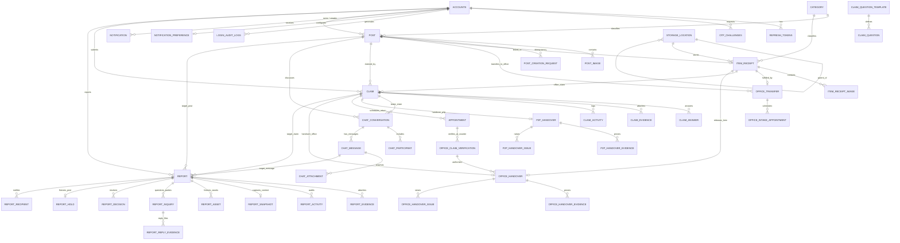
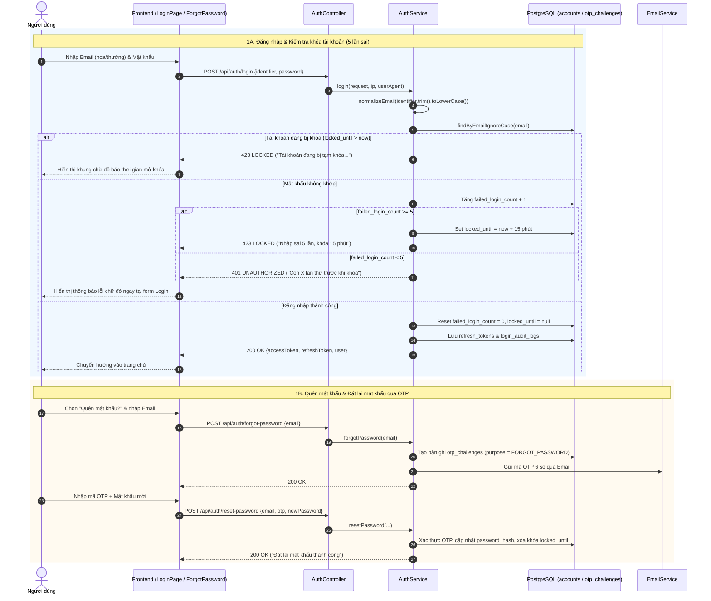
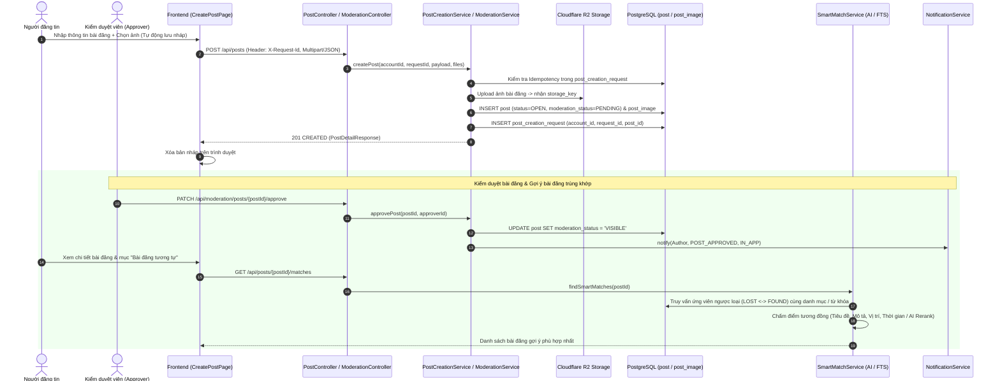
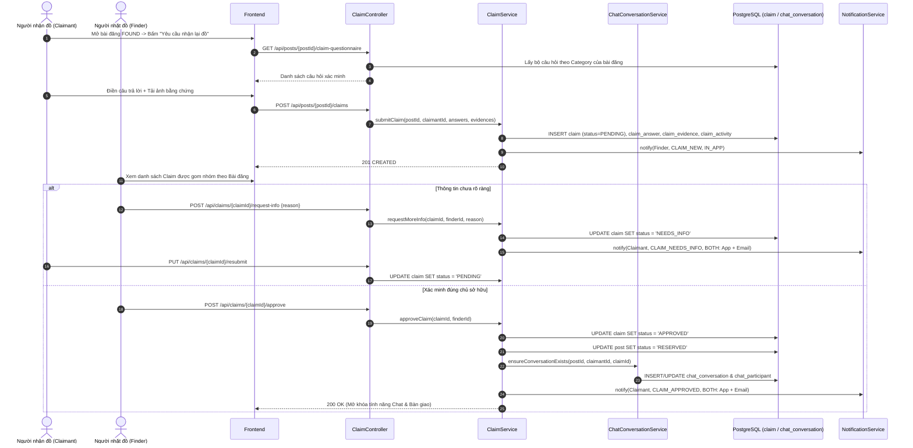
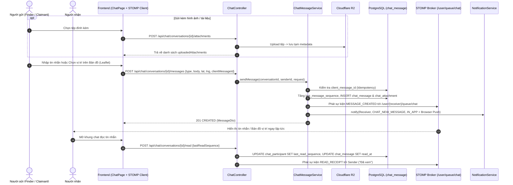
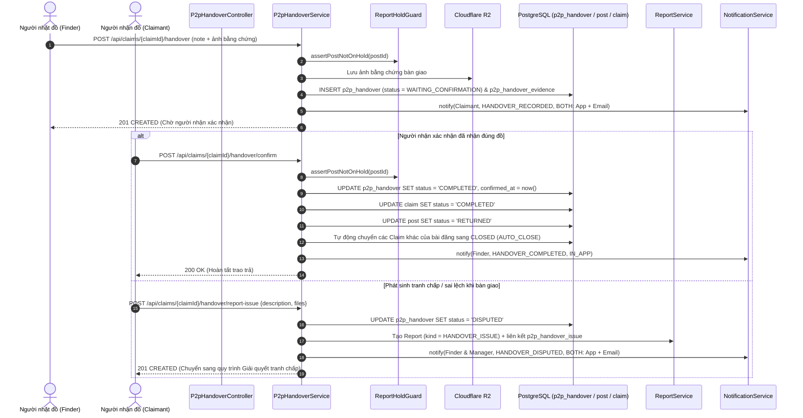
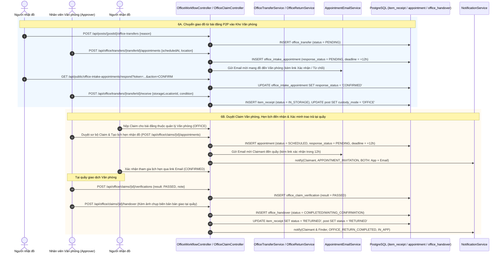
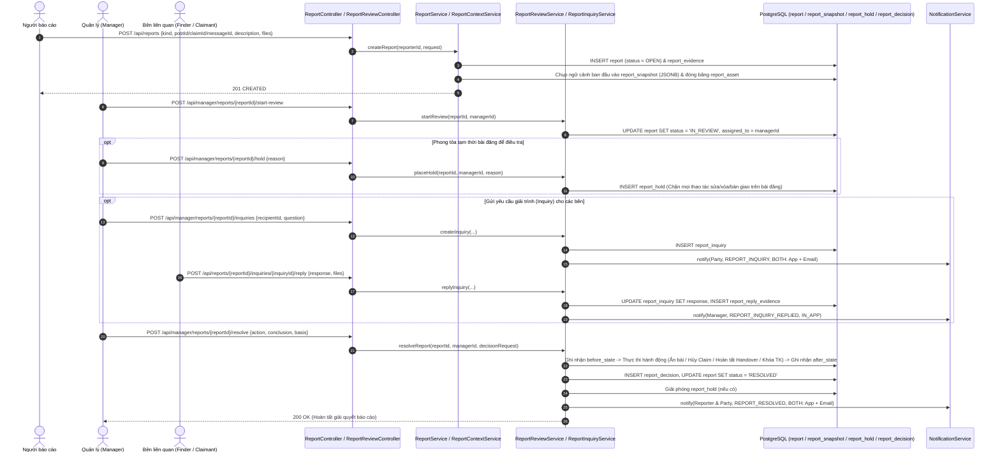

# 03. Tài Liệu Tổng Hợp (All-in-One): Cơ Sở Dữ Liệu & Sơ Đồ Tuần Tự — Hệ Thống Sagasu

⬅️ [Quay lại Trang chủ Kiến trúc](./README.md) | 🗄️ [01. Thiết kế CSDL & ERD](./01-database-schema.md) | 🔄 [02. Sơ đồ Tuần tự](./02-sequence-diagrams.md)

Tài liệu này tổng hợp đầy đủ cấu trúc Cơ sở dữ liệu (PostgreSQL) gồm **38 bảng** chia theo **8 phân hệ nghiệp vụ**, cùng **7 Sơ đồ tuần tự (Sequence Diagrams)** cho các luồng nghiệp vụ chính đang hoạt động trong hệ thống Tìm đồ thất lạc **Sagasu**.

---

## Phần 1: Thiết Kế Cơ Sở Dữ Liệu (Database Schema & ERD)

### 1.1. Tổng quan các phân hệ dữ liệu
Hệ thống sử dụng **PostgreSQL** kết hợp lưu trữ tệp đối tượng trên **Cloudflare R2** (lưu `storage_key` và tạo Presigned URL khi truy xuất) và tìm kiếm toàn văn (`tsvector` + GIN Index). Các bảng được chia thành 8 nhóm chính:

1. **Định danh, Xác thực & Kiểm toán (Identity, Auth & Audit)**: `accounts`, `refresh_tokens`, `otp_challenges`, `login_audit_logs`
2. **Danh mục, Bài đăng & Gợi ý thông minh (Categories, Posts & Smart Matching)**: `category`, `post`, `post_image`, `post_creation_request`
3. **Tiếp nhận Văn phòng, Kho lưu trữ & Chuyển giao (Office Intake, Storage & Transfer)**: `storage_location`, `item_receipt`, `item_receipt_image`, `office_transfer`, `office_intake_appointment`
4. **Yêu cầu nhận đồ & Bộ câu hỏi xác minh (Ownership Claims & Questionnaires)**: `claim_question_template`, `claim_question`, `claim`, `claim_answer`, `claim_evidence`, `claim_activity`
5. **Trò chuyện trực tuyến P2P (Real-time P2P Chat)**: `chat_conversation`, `chat_participant`, `chat_message`, `chat_attachment`
6. **Bàn giao đồ P2P & Trao trả tại Văn phòng (P2P Handover & Office Return)**: `p2p_handover`, `p2p_handover_evidence`, `p2p_handover_issue`, `appointment`, `office_claim_verification`, `office_handover`, `office_handover_evidence`, `office_handover_issue`
7. **Báo cáo vi phạm, Điều tra & Giải quyết tranh chấp (Reports, Investigation & Dispute Resolution)**: `report`, `report_evidence`, `report_activity`, `report_snapshot`, `report_asset`, `report_inquiry`, `report_reply_evidence`, `report_decision`, `report_hold`, `report_recipient`
8. **Thông báo đa kênh & Tùy chọn người dùng (Multi-Channel Notifications)**: `notification`, `notification_preference`

---

### 1.2. Sơ đồ Thực thể Liên kết (ERD - Mermaid)

---

### 1.3. Chi tiết các bảng theo Phân hệ

#### Phân hệ 1: Định danh, Xác thực & Kiểm toán (`01_init.sql`, `02_auth_otp_and_refresh.sql`)

| Bảng | Khóa chính (PK) | Khóa ngoại (FK) & Ràng buộc chính | Các cột chính & Trạng thái (Enum/Check) |
| :--- | :--- | :--- | :--- |
| **`accounts`** | `id` (`BIGSERIAL`) | `created_by` -> `accounts(id)` `email` (`UNIQUE`, chuẩn hóa chữ thường) | `full_name`, `email`, `phone`, `password_hash`, `role` (`USER`, `APPROVER`, `MANAGER`, `ADMIN`), `status` (`ACTIVE`, `SUSPENDED`, `DELETED`), `must_change_password`, `failed_login_count` (khóa sau 5 lần sai), `locked_until`, `valid_until`, `created_at`, `updated_at` |
| **`refresh_tokens`** | `id` (`BIGSERIAL`) | `account_id` -> `accounts(id)` (`ON DELETE CASCADE`) | `token_hash` (`UNIQUE` SHA-256), `expires_at`, `revoked_at`, `created_at` |
| **`otp_challenges`** | `id` (`BIGSERIAL`) | `account_id` -> `accounts(id)` (`ON DELETE CASCADE`) | `purpose` (`FORGOT_PASSWORD`, `CHANGE_PASSWORD`, `ACCOUNT_UNLOCK`), `otp_hash`, `expires_at`, `verified_at`, `consumed_at`, `attempt_count`, `created_at` |
| **`login_audit_logs`** | `id` (`BIGSERIAL`) | `account_id` -> `accounts(id)` (`ON DELETE SET NULL`) | `identifier`, `event_type`, `success`, `ip_address`, `user_agent`, `details` (`JSONB`), `created_at` |

---

#### Phân hệ 2: Danh mục, Bài đăng & Gợi ý thông minh (`04_lost_and_found_core.sql`, `07_post_And_Catagories.sql`, `11_post_image_uploads_and_storage.sql`, `22_post_creation_requests.sql`)

| Bảng | Khóa chính (PK) | Khóa ngoại (FK) & Ràng buộc chính | Các cột chính & Trạng thái (Enum/Check) |
| :--- | :--- | :--- | :--- |
| **`category`** | `category_id` (`BIGSERIAL`) | `name` (`UNIQUE`) | `name`, `is_active`, `created_at`, `updated_at` |
| **`post`** | `post_id` (`BIGSERIAL`) | `account_id` -> `accounts(id)` `created_by` -> `accounts(id)` `category_id` -> `category(category_id)` `moderated_by` -> `accounts(id)` | `post_type` (`LOST`, `FOUND`), `title`, `description`, `location_text`, `latitude`, `longitude`, `event_at`, `private_identifiers` (chỉ chủ bài/nhân viên thấy), `status` (`OPEN`, `RESERVED`, `RETURNED`, `CLOSED`, `ARCHIVED`), `custody_mode` (`P2P`, `OFFICE`), `moderation_status` (`PENDING`, `VISIBLE`, `REJECTED`, `HIDDEN`), `moderation_note`, `close_reason`, `deletion_reason`, `deleted_at`, `search_document` (`tsvector` GIN index) |
| **`post_image`** | `post_image_id` (`BIGSERIAL`) | `post_id` -> `post(post_id)` (`ON DELETE CASCADE`) `storage_key` (`UNIQUE`) | `storage_key` (Cloudflare R2 key), `image_url`, `mime_type`, `size_bytes`, `sort_order`, `created_at` |
| **`post_creation_request`** | `(account_id, request_id)` | `account_id` -> `accounts(id)` `post_id` -> `post(post_id)` | Đảm bảo **Idempotency** chống tạo trùng bài đăng khi mạng chập chờn hoặc người dùng bấm gửi nhiều lần (`request_id` dài tối đa 64 ký tự) |

---

#### Phân hệ 3: Tiếp nhận Văn phòng, Kho lưu trữ & Chuyển giao (`08_storage_and_office_intake.sql`, `14_office_transfer_reconciliation.sql`, `20_office_intake_appointments.sql`)

| Bảng | Khóa chính (PK) | Khóa ngoại (FK) & Ràng buộc chính | Các cột chính & Trạng thái (Enum/Check) |
| :--- | :--- | :--- | :--- |
| **`storage_location`** | `storage_location_id` (`BIGSERIAL`) | `parent_location_id` -> `storage_location(storage_location_id)` | `code` (`UNIQUE`, VD: `CAB-A-S1`), `name`, `capacity`, `is_active`, `created_at`, `updated_at` |
| **`item_receipt`** | `item_receipt_id` (`BIGSERIAL`) | `post_id` -> `post(post_id)` (`UNIQUE`) `category_id` -> `category(category_id)` `storage_location_id` -> `storage_location` `recorded_by`, `reviewed_by`, `received_by`, `assigned_officer_id` -> `accounts(id)` | `receipt_code` (`UNIQUE`), `source` (`WALK_IN`, `EXISTING_POST`), `title`, `description`, `private_identifiers`, `found_at`, `found_location`, `temporary_location`, `review_status` (`PENDING`, `NEEDS_INFO`, `ACCEPTED`, `REJECTED`), `finder_name`, `finder_contact`, `condition_at_receipt`, `status` (`DRAFT`, `SUBMITTED`, `IN_STORAGE`, `RETURNED`, `REJECTED`) |
| **`item_receipt_image`** | `item_receipt_image_id` (`BIGSERIAL`) | `item_receipt_id` -> `item_receipt(item_receipt_id)` (`ON DELETE CASCADE`) | `storage_key` (`UNIQUE`), `image_url`, `mime_type`, `size_bytes`, `is_sensitive` (ảnh chứa thông tin nhạy cảm), `sort_order`, `uploaded_at` |
| **`office_transfer`** | `transfer_id` (`BIGSERIAL`) | `post_id` -> `post(post_id)` `requested_by`, `processed_by` -> `accounts(id)` `item_receipt_id` -> `item_receipt(item_receipt_id)` | `status` (`PENDING`, `RECEIVED`, `REJECTED`, `CANCELLED`), `reason`, `reconciliation_note`, `requested_at`, `processed_at`, `version` (Optimistic Lock) |
| **`office_intake_appointment`** | `appointment_id` (`BIGSERIAL`) | `transfer_id` -> `office_transfer(transfer_id)` (`ON DELETE CASCADE`) `created_by` -> `accounts(id)` | `scheduled_at`, `location`, `note`, `status` (`SCHEDULED`, `CANCELLED`, `COMPLETED`), `email_status` (`UNSENT`, `SENT`, `FAILED`), `response_status` (`UNSENT`, `PENDING`, `CONFIRMED`, `DECLINED`, `EXPIRED`), `response_token_hash`, `response_deadline` (12 giờ), `responded_at`, `cancellation_reason` |

---

#### Phân hệ 4: Yêu cầu nhận đồ & Bộ câu hỏi xác minh (`09_p2p_claims_and_chat.sql`, `12_claim_questionnaires.sql`, `15_office_claims.sql`)

| Bảng | Khóa chính (PK) | Khóa ngoại (FK) & Ràng buộc chính | Các cột chính & Trạng thái (Enum/Check) |
| :--- | :--- | :--- | :--- |
| **`claim_question_template`** | `template_id` (`BIGSERIAL`) | `category_name` (`UNIQUE`) `template_code` (`UNIQUE`) | `category_name`, `template_code`, `version`, `active` |
| **`claim_question`** | `question_id` (`BIGSERIAL`) | `template_id` -> `claim_question_template(template_id)` (`ON DELETE CASCADE`) | `question_code`, `section_title`, `question_label`, `placeholder`, `help_text`, `required`, `max_length`, `sort_order` |
| **`claim`** | `claim_id` (`BIGSERIAL`) | `post_id` -> `post(post_id)` `claimant_id` -> `accounts(id)` (Nullable khi nộp tại quầy) `created_by` -> `accounts(id)` `item_receipt_id` -> `item_receipt(item_receipt_id)` | `claim_type` (`P2P`, `OFFICE`), `submission_channel` (`ONLINE`, `COUNTER`), `claimant_name`, `claimant_email`, `claimant_phone`, `description`, `evidence_note`, `status` (`PENDING`, `NEEDS_INFO`, `APPROVED`, `REJECTED`, `CANCELLED`, `COMPLETED`, `CLOSED`), `close_reason`, `closed_at`, `version` |
| **`claim_answer`** | `claim_answer_id` (`BIGSERIAL`) | `claim_id` -> `claim(claim_id)` (`ON DELETE CASCADE`) | Lưu bản chụp (snapshot) câu hỏi & câu trả lời lúc nộp: `template_code`, `template_version`, `section_title`, `question_code`, `question_label`, `answer_text`, `sort_order` |
| **`claim_evidence`** | `claim_evidence_id` (`BIGSERIAL`) | `claim_id` -> `claim(claim_id)` (`ON DELETE CASCADE`) | `storage_key` (`UNIQUE`), `original_name`, `mime_type`, `size_bytes`, `content_hash` (SHA-256 chống trùng), `sort_order`, `uploaded_at` |
| **`claim_activity`** | `claim_activity_id` (`BIGSERIAL`) | `claim_id` -> `claim(claim_id)` (`ON DELETE CASCADE`) `actor_id` -> `accounts(id)` | `action` (`SUBMIT`, `APPROVE`, `REJECT`, `REQUEST_INFO`, `RESUBMIT`, `CANCEL`, `HANDOVER`, `INVITE_CONFIRM`, `RESCHEDULE`, `CONFIRM_RECEIPT`, `AUTO_CLOSE`, `REPORT_ISSUE`, `DISPUTE_RESOLVE`, `INVITE_DECLINE`, `INVITE_EXPIRE`, `OFFICE_CANCEL`, `TRANSFER_OFFICE`), `from_status`, `to_status`, `reason`, `created_at` |

---

#### Phân hệ 5: Trò chuyện trực tuyến P2P (`09_p2p_claims_and_chat.sql`, `19_chat_location_messages.sql`)

| Bảng | Khóa chính (PK) | Khóa ngoại (FK) & Ràng buộc chính | Các cột chính & Trạng thái (Enum/Check) |
| :--- | :--- | :--- | :--- |
| **`chat_conversation`** | `conversation_id` (`BIGSERIAL`) | `post_id` -> `post(post_id)` `claimant_id` -> `accounts(id)` `latest_claim_id` -> `claim(claim_id)` `UNIQUE (post_id, claimant_id)` | `last_message_sequence`, `last_activity_at`, `created_at`, `updated_at`, `version` |
| **`chat_participant`** | `(conversation_id, account_id)` | `conversation_id` -> `chat_conversation` `account_id` -> `accounts(id)` | `participant_role` (`FINDER`, `CLAIMANT`), `last_read_sequence`, `last_read_at`, `joined_at` |
| **`chat_message`** | `message_id` (`BIGSERIAL`) | `(conversation_id, sender_id)` -> `chat_participant` | `sequence_no`, `client_message_id` (`UUID` chống gửi lặp), `message_type` (`TEXT`, `ATTACHMENT`, `MIXED`, `LOCATION`), `body`, `latitude`, `longitude`, `location_label`, `read_at`, `created_at` |
| **`chat_attachment`** | `attachment_id` (`BIGSERIAL`) | `message_id` -> `chat_message(message_id)` (`ON DELETE CASCADE`) | `storage_key` (`UNIQUE`), `original_name`, `mime_type`, `size_bytes`, `content_hash`, `sort_order`, `uploaded_at` |

---

#### Phân hệ 6: Bàn giao đồ P2P & Trao trả tại Văn phòng (`10_handover_return_and_reports.sql`, `16_office_invitations_and_return.sql`)

| Bảng | Khóa chính (PK) | Khóa ngoại (FK) & Ràng buộc chính | Các cột chính & Trạng thái (Enum/Check) |
| :--- | :--- | :--- | :--- |
| **`p2p_handover`** | `handover_id` (`BIGSERIAL`) | `claim_id` -> `claim(claim_id)` (`UNIQUE`) `recorded_by`, `confirmed_by` -> `accounts(id)` | `recorded_at`, `note`, `status` (`WAITING_CONFIRMATION`, `COMPLETED`, `DISPUTED`, `CANCELLED`), `confirmed_at`, `client_request_id`, `request_hash`, `version` |
| **`p2p_handover_evidence`** | `evidence_id` (`BIGSERIAL`) | `handover_id` -> `p2p_handover(handover_id)` (`ON DELETE CASCADE`) | `storage_key` (`UNIQUE`), `original_name`, `mime_type`, `size_bytes`, `content_hash`, `sort_order` |
| **`p2p_handover_issue`** | `report_id` (`BIGINT`) | `report_id` -> `report(report_id)` `handover_id` -> `p2p_handover(handover_id)` | Liên kết biên bản bàn giao P2P bị khiếu nại với phiếu `report` loại `HANDOVER_ISSUE` |
| **`appointment`** | `appointment_id` (`BIGSERIAL`) | `claim_id` -> `claim(claim_id)` (`ON DELETE CASCADE`) `created_by` -> `accounts(id)` | Lịch hẹn nhận lại đồ tại văn phòng: `scheduled_at`, `location`, `note`, `status` (`SCHEDULED`, `CANCELLED`, `COMPLETED`), `response_status` (`UNSENT`, `PENDING`, `CONFIRMED`, `DECLINED`, `EXPIRED`), `response_token_hash`, `response_deadline` |
| **`office_claim_verification`** | `verification_id` (`BIGSERIAL`) | `claim_id` -> `claim(claim_id)` `appointment_id` -> `appointment(appointment_id)` `verified_by` -> `accounts(id)` | Biên bản xác minh trực tiếp tại quầy: `verified_at`, `result` (`PASSED`, `FAILED`), `note` |
| **`office_handover`** | `handover_id` (`BIGSERIAL`) | `claim_id` -> `claim(claim_id)` (`UNIQUE`) `item_receipt_id` -> `item_receipt(item_receipt_id)` (`UNIQUE`) `verification_id` -> `office_claim_verification` | `recorded_by`, `recipient_id`, `recorded_at`, `condition_note`, `status` (`WAITING_CONFIRMATION`, `COMPLETED`, `DISPUTED`), `confirmed_at`, `issue_note`, `version` |
| **`office_handover_evidence`** | `evidence_id` (`BIGSERIAL`) | `handover_id` -> `office_handover(handover_id)` (`ON DELETE CASCADE`) | `storage_key` (`UNIQUE`), `original_name`, `mime_type`, `size_bytes`, `content_hash`, `sort_order` |
| **`office_handover_issue`** | `report_id` (`BIGINT`) | `report_id` -> `report(report_id)` `handover_id` -> `office_handover(handover_id)` | Liên kết biên bản trao trả văn phòng có sự cố với phiếu `report` |

---

#### Phân hệ 7: Báo cáo vi phạm, Điều tra & Giải quyết tranh chấp (`10_handover_return_and_reports.sql`, `17_report_review_Resolution.sql`, `18_report_context_and_inquiry.sql`)

| Bảng | Khóa chính (PK) | Khóa ngoại (FK) & Ràng buộc chính | Các cột chính & Trạng thái (Enum/Check) |
| :--- | :--- | :--- | :--- |
| **`report`** | `report_id` (`BIGSERIAL`) | `reporter_id`, `reported_account_id`, `assigned_to`, `resolved_by` -> `accounts(id)` `post_id` -> `post`, `claim_id` -> `claim`, `message_id` -> `chat_message` | `kind` (`GENERAL`, `HANDOVER_ISSUE`), `description`, `status` (`OPEN`, `IN_REVIEW`, `RESOLVED`, `REJECTED`), `assigned_at`, `resolution_note`, `resolved_at`, `version` |
| **`report_evidence`** | `evidence_id` (`BIGSERIAL`) | `report_id` -> `report(report_id)` (`ON DELETE CASCADE`) | Bằng chứng người tố cáo đính kèm: `storage_key`, `original_name`, `mime_type`, `size_bytes`, `content_hash` |
| **`report_activity`** | `activity_id` (`BIGSERIAL`) | `report_id` -> `report(report_id)` `actor_id` -> `accounts(id)` | Lịch sử xử lý báo cáo (`SUBMIT`, `START_REVIEW`, `HOLD_POST`, `RELEASE_HOLD`, `INQUIRY_SENT`, `INQUIRY_REPLIED`, `RESOLVE`, `REJECT`), `public_note`, `internal_note` |
| **`report_snapshot`** | `report_id` (`BIGINT`) | `report_id` -> `report(report_id)` (`ON DELETE CASCADE`) | Chụp nguyên trạng dữ liệu bài đăng/claim/chat/handover tại thời điểm báo cáo (`payload` kiểu `JSONB`, `capture_source`: `SUBMISSION`, `FIRST_REVIEW`) |
| **`report_asset`** | `asset_id` (`BIGSERIAL`) | `report_id` -> `report(report_id)` (`ON DELETE CASCADE`) | Đóng băng các tệp hình ảnh/bằng chứng liên quan (`source`: `REPORT`, `POST`, `CLAIM`, `CHAT`, `P2P_HANDOVER`, `OFFICE_HANDOVER`, `INQUIRY_REPLY`) |
| **`report_inquiry`** | `inquiry_id` (`BIGSERIAL`) | `report_id` -> `report(report_id)` `recipient_id`, `created_by` -> `accounts(id)` | Câu hỏi xác minh của Manager gửi cho các bên liên quan: `question`, `created_at`, `response`, `responded_at` |
| **`report_reply_evidence`** | `evidence_id` (`BIGSERIAL`) | `inquiry_id` -> `report_inquiry(inquiry_id)` (`ON DELETE CASCADE`) | Tệp bằng chứng người dùng phản hồi cho câu hỏi điều tra của Manager |
| **`report_decision`** | `decision_id` (`BIGSERIAL`) | `report_id` -> `report(report_id)` `actor_id` -> `accounts(id)` | Quyết định xử lý của Manager: `action`, `conclusion`, `basis`, `before_state` (`JSONB`), `after_state` (`JSONB`) |
| **`report_hold`** | `report_id` (`BIGINT`) | `report_id` -> `report(report_id)` `post_id` -> `post(post_id)` | Lệnh phong tỏa tạm thời bài đăng (`ReportHoldGuard`) ngăn chỉnh sửa/bàn giao khi đang điều tra: `reason`, `created_at`, `released_at` |
| **`report_recipient`** | `(report_id, account_id)` | `report_id` -> `report(report_id)` `account_id` -> `accounts(id)` | Danh sách tài khoản nhận thông báo kết quả giải quyết báo cáo |

---

#### Phân hệ 8: Thông báo đa kênh & Tùy chọn người dùng (`21_notifications.sql`)

| Bảng | Khóa chính (PK) | Khóa ngoại (FK) & Ràng buộc chính | Các cột chính & Trạng thái (Enum/Check) |
| :--- | :--- | :--- | :--- |
| **`notification`** | `notification_id` (`BIGSERIAL`) | `recipient_id` -> `accounts(id)` (`ON DELETE CASCADE`) | `type`, `channel` (`IN_APP`, `BOTH`), `title`, `content`, `target_url`, `is_read`, `read_at`, `created_at` |
| **`notification_preference`** | `account_id` (`BIGINT`) | `account_id` -> `accounts(id)` (`ON DELETE CASCADE`) | Cài đặt chủ động của người dùng: `in_app_enabled` (`BOOLEAN`), `email_enabled` (`BOOLEAN`), `browser_push_enabled` (`BOOLEAN`), `updated_at` |

---

## Phần 2: Sơ Đồ Tuần Tự (Sequence Diagrams) Các Luồng Nghiệp Vụ Chính

### Luồng 1: Đăng nhập (Tự động chuẩn hóa Email, Khóa sau 5 lần sai) & Quên mật khẩu qua OTP

- **Đặc điểm chính**:
  - Email đăng nhập không phân biệt hoa thường (`normalizeEmail`).
  - Sai mật khẩu hiển thị cảnh báo chữ đỏ ngay tại trang Login kèm số lần thử còn lại.
  - Nhập sai 5 lần liên tiếp sẽ khóa tài khoản tạm thời 15 phút (`locked_until`).
  - Người dùng lấy lại quyền truy cập qua luồng **Quên mật khẩu** với mã OTP 6 số gửi qua Email.

---

### Luồng 2: Đăng tin Đồ thất lạc / Nhặt được, Kiểm duyệt & Gợi ý Thông minh (Smart Match AI)

- **Đặc điểm chính**:
  - Hỗ trợ lưu nháp trên trình duyệt (`localStorage` theo tài khoản) và chống gửi trùng lặp bằng khóa `X-Request-Id` (`post_creation_request`).
  - Tải ảnh trực tiếp hoặc qua backend lên **Cloudflare R2** (`post_image`).
  - Khi bài đăng được duyệt (`VISIBLE`), hệ thống kích hoạt tìm kiếm các bài đăng đối ứng (`LOST` <-> `FOUND`) bằng PostgreSQL Full-Text Search kết hợp chấm điểm tương đồng (`SmartMatchService`) và gửi thông báo cho chủ bài.

---

### Luồng 3: Xác minh quyền sở hữu P2P (Submit Claim + Questionnaire) & Mở phòng Chat

- **Đặc điểm chính**:
  - Người nhận đồ (Claimant) phải trả lời **Bộ câu hỏi xác minh theo danh mục** (`claim_question_template`) và đính kèm ảnh bằng chứng (`claim_evidence`).
  - Người nhặt được đồ (Finder) đối chiếu câu trả lời với `private_identifiers` của bài đăng: có thể **Yêu cầu bổ sung thông tin (`NEEDS_INFO`)**, **Từ chối (`REJECTED`)**, hoặc **Chấp nhận (`APPROVED`)**.
  - Khi một Claim được `APPROVED`, bài đăng chuyển sang `RESERVED` và hệ thống tự động khởi tạo/kích hoạt phòng **Chat P2P** (`chat_conversation`).

---

### Luồng 4: Trò chuyện P2P thời gian thực (Text, Tệp đính kèm, Vị trí bản đồ & Đã xem)

- **Đặc điểm chính**:
  - Hỗ trợ gửi tin nhắn văn bản (`TEXT`), đính kèm ảnh/PDF (`ATTACHMENT` / `MIXED`), và chia sẻ tọa độ điểm hẹn trên bản đồ (`LOCATION` với `latitude`, `longitude`, `location_label`).
  - Đồng bộ thời gian thực qua **WebSocket STOMP** (`/ws/chat`) kèm thông báo đẩy trên trình duyệt (Browser Notification) khi tab đang ẩn.

---

### Luồng 5: Bàn giao đồ P2P (Lập biên bản, Xác nhận hoàn tất hoặc Báo cáo sự cố)

- **Đặc điểm chính**:
  - Trước khi thao tác, `ReportHoldGuard` kiểm tra xem bài đăng có đang bị phong tỏa do tranh chấp hay không.
  - Người nhặt đồ lập biên bản bàn giao kèm ảnh minh chứng (`WAITING_CONFIRMATION`).
  - Người nhận đồ xác nhận đã nhận (`COMPLETED` -> bài đăng chuyển sang `RETURNED`, tự động đóng các claim khác), hoặc báo cáo sự cố (`DISPUTED` -> tạo phiếu `report` loại `HANDOVER_ISSUE` để Manager xử lý).

---

### Luồng 6: Nghiệp vụ Văn phòng (Chuyển giao / Lưu kho -> Đặt lịch hẹn Email Token 12h -> Xác minh & Trao trả tại quầy)

- **Đặc điểm chính**:
  - Hỗ trợ 2 nguồn đồ vào kho Văn phòng: **Người dùng đăng bài P2P rồi xin chuyển cho Văn phòng (`office_transfer`)** hoặc **Mang đồ đến nộp trực tiếp tại quầy (`WALK_IN`)**.
  - Mọi lịch hẹn (Nộp đồ vào văn phòng hoặc Nhận lại đồ từ văn phòng) đều gửi **Email kèm liên kết Token có thời hạn phản hồi 12 giờ** (`CONFIRMED` / `DECLINED` / tự động `EXPIRED` qua Cron Job).
  - Khi trao trả tại quầy, nhân viên thực hiện bước **Xác minh trực tiếp (`office_claim_verification`)** trước khi lập biên bản xuất kho (`office_handover`).

---

### Luồng 7: Báo cáo vi phạm, Điều tra của Manager (Chụp Snapshot, Phong tỏa bài đăng, Hỏi đáp Inquiry) & Quyết định xử lý

- **Đặc điểm chính**:
  - Ngay khi báo cáo được gửi hoặc khi Manager bắt đầu xem xét (`IN_REVIEW`), hệ thống tự động chụp **Snapshot toàn bộ ngữ cảnh** (`report_snapshot` & `report_asset`) để tránh việc các bên sửa/xóa dữ liệu phi tang.
  - Manager có thể bật **Phong tỏa bài đăng (`report_hold`)**, gửi **Câu hỏi điều tra (`report_inquiry`)** yêu cầu các bên giải trình kèm bằng chứng (`report_reply_evidence`), và ban hành **Quyết định xử lý (`report_decision`)** tự động cập nhật trạng thái Bài đăng / Claim / Handover / Tài khoản.

