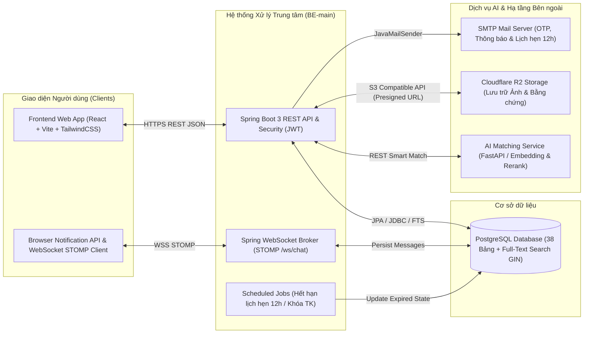

# Kiến Trúc Hệ Thống, Cơ Sở Dữ Liệu & Sơ Đồ Tuần Tự — Sagasu (Lost & Found Platform)

Chào mừng bạn đến với thư mục tài liệu kiến trúc (`architecture/`) của dự án **SEP490 — Sagasu**. Thư mục này được tổ chức thành các tài liệu Markdown tích hợp sẵn biểu đồ **Mermaid** hiển thị trực tiếp trên GitHub.

---

## 📑 Mục Lục Tài Liệu

| STT | Tài liệu | Nội dung chính |
| :-: | :--- | :--- |
| **01** | [**Thiết Kế Cơ Sở Dữ Liệu & Sơ Đồ ERD**](./01-database-schema.md) | Sơ đồ ERD tổng thể + ERD chi tiết theo từng phân hệ (8 phân hệ, 38 bảng PostgreSQL), khóa chính/khóa ngoại, kiểu dữ liệu và các trạng thái nghiệp vụ. |
| **02** | [**Sơ Đồ Tuần Tự (Sequence Diagrams)**](./02-sequence-diagrams.md) | 7 Sequence Diagrams chi tiết cho các luồng nghiệp vụ cốt lõi: Đăng nhập & OTP, Đăng bài & Smart Match AI, Claim & Questionnaire, Chat P2P, Bàn giao P2P, Nghiệp vụ Văn phòng, Điều tra & Giải quyết Báo cáo. |
| **03** | [**Tài Liệu Tổng Hợp (All-in-One)**](./03-full-overview.md) | Bản gộp đầy đủ cả Database Schema & Sequence Diagrams trong một file duy nhất để tiện tra cứu nhanh hoặc xuất PDF. |
| **04** | [**Thống Kê BE/FE & Bảng WBS Project Tracking**](./04-wbs-be-fe-inventory.md) | Thống kê chi tiết 14 Module / 21 Controller / 117 API Backend, 33 Màn hình Frontend và bảng WBS Project Tracking chuẩn 8 cột SEP490. |

---

## 🏗️ Sơ Đồ Kiến Trúc Tổng Thể Hệ Thống (System Architecture)

---

## 🧩 Tóm Tắt 8 Phân Hệ Cơ Sở Dữ Liệu (38 Bảng)

1. **Định danh, Xác thực & Kiểm toán (`4 bảng`)**: `accounts`, `refresh_tokens`, `otp_challenges`, `login_audit_logs`
2. **Danh mục, Bài đăng & Gợi ý thông minh (`4 bảng`)**: `category`, `post`, `post_image`, `post_creation_request`
3. **Tiếp nhận Văn phòng, Kho lưu trữ & Chuyển giao (`5 bảng`)**: `storage_location`, `item_receipt`, `item_receipt_image`, `office_transfer`, `office_intake_appointment`
4. **Yêu cầu nhận đồ & Bộ câu hỏi xác minh (`6 bảng`)**: `claim_question_template`, `claim_question`, `claim`, `claim_answer`, `claim_evidence`, `claim_activity`
5. **Trò chuyện trực tuyến P2P (`4 bảng`)**: `chat_conversation`, `chat_participant`, `chat_message`, `chat_attachment`
6. **Bàn giao đồ P2P & Trao trả tại Văn phòng (`8 bảng`)**: `p2p_handover`, `p2p_handover_evidence`, `p2p_handover_issue`, `appointment`, `office_claim_verification`, `office_handover`, `office_handover_evidence`, `office_handover_issue`
7. **Báo cáo vi phạm, Điều tra & Giải quyết tranh chấp (`10 bảng`)**: `report`, `report_evidence`, `report_activity`, `report_snapshot`, `report_asset`, `report_inquiry`, `report_reply_evidence`, `report_decision`, `report_hold`, `report_recipient`
8. **Thông báo đa kênh & Tùy chọn người dùng (`2 bảng`)**: `notification`, `notification_preference`

---

## 🔄 Tóm Tắt 7 Luồng Nghiệp Vụ Chính

1. **[Luồng 1 — Đăng nhập & Quên mật khẩu](./02-sequence-diagrams.md#luồng-1-đăng-nhập-tự-động-chuẩn-hóa-email-khóa-sau-5-lần-sai--quên-mật-khẩu-qua-otp)**: Chuẩn hóa email hoa/thường, cảnh báo chữ đỏ tại chỗ khi sai mật khẩu, khóa tạm thời 15 phút sau 5 lần thử sai, lấy lại mật khẩu qua OTP Email.
2. **[Luồng 2 — Đăng tin, Kiểm duyệt & Smart Match AI](./02-sequence-diagrams.md#luồng-2-đăng-tin-đồ-thất-lạc--nhặt-được-kiểm-duyệt--gợi-ý-thông-minh-smart-match-ai)**: Lưu nháp tự động, chống gửi trùng (`X-Request-Id`), lưu ảnh trên Cloudflare R2, duyệt bài và tự động gợi ý các bài đăng thất lạc/nhặt được tương ứng.
3. **[Luồng 3 — Xác minh quyền sở hữu P2P (Claim & Questionnaire)](./02-sequence-diagrams.md#luồng-3-xác-minh-quyền-sở-hữu-p2p-submit-claim--questionnaire--mở-phòng-chat)**: Trả lời bộ câu hỏi theo danh mục đồ vật, đính kèm bằng chứng, yêu cầu bổ sung thông tin (`NEEDS_INFO`), duyệt Claim (`APPROVED`) và mở phòng Chat P2P.
4. **[Luồng 4 — Trò chuyện P2P thời gian thực](./02-sequence-diagrams.md#luồng-4-trò-chuyện-p2p-thời-gian-thực-text-tệp-đính-kèm-vị-trí-bản-đồ--đã-xem)**: Gửi tin nhắn văn bản, hình ảnh/PDF, chia sẻ vị trí hẹn gặp trên bản đồ (`LOCATION`) và cập nhật trạng thái đã xem (`READ_RECEIPT`) qua STOMP WebSocket.
5. **[Luồng 5 — Bàn giao đồ P2P](./02-sequence-diagrams.md#luồng-5-bàn-giao-đồ-p2p-lập-biên-bản-xác-nhận-hoàn-tất-hoặc-báo-cáo-sự-cố)**: Lập biên bản bàn giao kèm ảnh minh chứng, người nhận xác nhận hoàn tất (`COMPLETED`) hoặc báo cáo sự cố (`DISPUTED`) chuyển lên Manager.
6. **[Luồng 6 — Nghiệp vụ Văn phòng (Kho & Lịch hẹn 12h)](./02-sequence-diagrams.md#luồng-6-nghiệp-vụ-văn-phòng-chuyển-giao--lưu-kho---đặt-lịch-hẹn-email-token-12h---xác-minh--trao-trả-tại-quầy)**: Chuyển giao đồ vào kho văn phòng hoặc tiếp nhận tại quầy, gửi email lịch hẹn kèm link xác nhận trong 12 giờ, xác minh trực tiếp tại quầy và xuất kho trao trả.
7. **[Luồng 7 — Báo cáo vi phạm, Điều tra & Giải quyết tranh chấp](./02-sequence-diagrams.md#luồng-7-báo-cáo-vi-phạm-điều-tra-của-manager-chụp-snapshot-phong-tỏa-bài-đăng-hỏi-đáp-inquiry--quyết-định-xử-lý)**: Tự động chụp Snapshot ngữ cảnh (`report_snapshot`), phong tỏa bài đăng (`report_hold`), gửi câu hỏi điều tra (`report_inquiry`) và ban hành quyết định xử lý (`report_decision`).
